# 🌊 FluidFullSpeedSimulation

💧 水・🍶 エタノール・🧴 メタノールなどの作動流体で、**流れ・遅れ・検証**を整数演算で回すシミュレーター。

- 🏛️ 手本は MONIAC（フィリップス・マシン, 1949）の「水が流れ落ちる様子」。経済の解釈は扱わず、部品（水槽・管・堰・浮き弁・遅延管・連結）を物理のまま再現する
- 🎋 部品の組み合わせで、流しそうめんの台のような別の題材にも広げられる汎用の回路にしている
- 🧮 量はすべて Q 整数（固定小数点）。移した量をそのまま足し引きするので、総量は 1 ulp も変わらない
- 🟦 見せ方は絵文字のブロックを積む断面図（行 = 高さ、列 = 区間・水槽）。溜まる・流れる・遅れるがそのまま見える

## 🎞️ デモ（場面ごとに GIF 1 枚）

`draw` の場面を既定の引数で 1 枚ずつ。断面図は 16 段・40 時刻（最初と最後で一息）、ドット絵は `draw --view files` と同じ。

| 🎞️ | 見どころ |
|---|---|
| 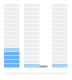 | **D01 🏛️ `moniac-rig`**<br>列: 頭 ｜ 貯める槽 ｜ 戻りの管 ｜ 横の槽。頭から弁で分かれて、貯める槽と横の槽が溜まっていく（0〜20 分） |
|  | **D02 🕳️ `moniac-drain`**<br>ドット絵: 水槽の底の穴から抜けて、床に広がって平らになる |
| 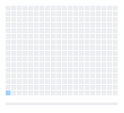 | **D03 🎋 `flume`**<br>空の樋（20 区間）にポンプで流し込む。先端が区間ごとに遅れて届き、10 秒で 🟨 の 🍜 を放す（0〜60 秒） |
| 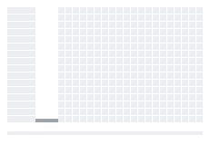 | **D04 🫙 `flume-hopper`**<br>列: じょうご ｜ 遅れ 3 秒の細管（灰色）｜ 樋。じょうごに溜まってから管を通って樋へ（0〜90 秒） |
| 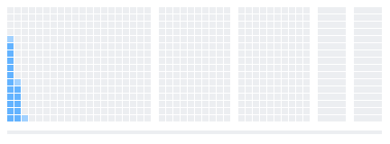 | **D05 🥢 `somen-flume`**<br>列: 竹 3 本 ｜ 受け皿 ｜ 床。継ぎ目の手前にたまりができ、🍜 3 本が流れていく（0〜40 秒） |
| 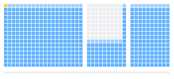 | **D06 🍜 `noodle-length`**<br>長さ 30 cm の麺が区間をまたいで流れる（体 = 頭の後ろの区間を合計 L まで） |
| 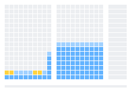 | **D07 🧱 `noodle-clog`**<br>細い流れで束が縁に積もり、たまりが上がって、最後に全部まとめて受け皿へ流れ出す（100〜200 秒） |
| 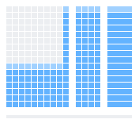 | **D08 🍽️ `chopsticks`**<br>箸で取られた 🍜 はそこで消える。取り逃した分だけ受け皿へ（24〜50 秒） |
| 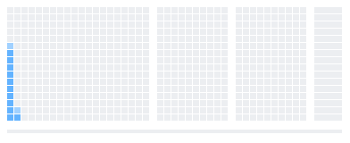 | **D09 🧊 `cold-water`**<br>10 °C の細い流れ。ひやむぎ・そうめんの 2 本が流れる（0〜110 秒） |
| 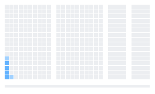 | **D10 🪵 `bamboo-wear`**<br>列: 節のある竹 ｜ 次の竹 ｜ 受け皿 ｜ 床。節の手前にたまり、うどんだけ節で止まる。割れ目の漏れが床へ（0〜100 秒） |
|  | **D11 🌧️ `rain-runoff`**<br>列: 斜面（20 区間）｜ 受け皿。雨が行き渡って下流ほど深く、やむと引いていく（0〜286 秒） |
|  | **D12 🎍 `shishi-odoshi`**<br>列: 筒 ｜ 受け皿。筒はのこぎり歯（溜まる → 傾く → 空く）、受け皿は階段 |
|  | **D13 🍷 `pythagorean-cup` 🟪**<br>列: 杯 ｜ 鉢。頂まで溜まると吸い切られ、鉢が階段。☠️ Poison Water（粘度 5 倍）で |
|  | **D14 🫗 `mariotte`**<br>列: びん ｜ 受け皿。空気管の下端までは一定の速さで下がり、その先は Torricelli で鈍る |
|  | **D15 🏺 `water-clock`**<br>列: 4 次の放物面 ｜ 筒 ｜ 円すい（口は同じ）。🏺 は一定の速さで下がって空になり、筒は下ほど遅く残り、円すいは先に空く |
|  | **D16 🌊 `dam-break` 🟩**<br>ドット絵のダム決壊。🟩 Namekian Water（粘度 0.8 倍）で |
|  | **D17 🚧 `inertia-limits`**<br>ダム決壊を断面図で（勾配 1 %）。慣性が無いので先端は尖らず、盛り上がったまま下流へずれる（Ritter とは別物、E23） |
| 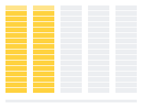 | **D18 ⚗️ `distillation` 🟨**<br>列: 釜 ｜ 前留 ｜ ハート ｜ セコンド ｜ 後留。釜が減り、受け器が順に溜まる（0〜50 分。🟨 は色だけ） |
|  | **D19 👼 `angels-share` 🟧**<br>列: スコットランド ｜ ケンタッキー上の階 ｜ 同 下の階 ｜ 台湾。樽が 30 年かけて減る（1 フレーム = 1 年。🟧 は色だけ） |
|  | **D20 💴 `money-flow` 🟩**<br>列: 中央銀行 ｜ メガ銀行 a ｜ T+2 の管 ｜ 証券 a ｜ b ｜ c … ｜ 市中。中央銀行は十分大きい有限の初期残高（2^20 兆）から送り出し、銀行・証券・市中が「出す速さ × 滞在時間」まで溜まる（0〜64 日） |
|  | **D21 🪙 `gold-flow` 🟨**<br>同じ配管に金（総量 128 t）。金庫が減って行き渡り、取り分は滞在時間の比で止まる。1 段 = 総量の 1/16（0〜64 日） |
| 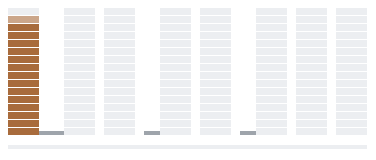 | **D22 ⛏️ `rare-metal` 🟫**<br>列: 産出国 ｜ 船 30 日 ｜ 製錬の加工国 ｜ 部品の加工国 … ｜ 市場。産出国が指数で減り、加工国の在庫は山を作ってから消え、市場に積もる（0〜320 日） |
|  | **D23 🚿 `outlet-count`**<br>列: 別々に取る 1 本 ｜ 2 本 ｜ 4 本 ｜ 8 本 ｜ 厳密に解く 8 本（合計の速さは同じ）。別々に取ると本数が多いほど速く空く。厳密に解く 8 本（右端）は 1 本（左端）と同じ。ずれが見えるように刻みをわざと粗くしてある（dt = τ/2、0〜32 日） |

- 🟦 1 段 = 縦いっぱい / 16。縦いっぱいは走らせた中の最大（樋は全区間で共通、水槽はそれぞれ）。いちばん上の段は明るい色（水面）。💴 は中央銀行を除く槽、🪙 ⛏️ は全槽で縦いっぱいを揃えてあるので、その範囲内で列をまたいで量を比べられる。💴 の中央銀行は別スケールで、他の槽と高さを比較できない
- 🟨 は運ばれる物（🍜）、灰色の帯は遅れのある管、下の帯は時刻（最初 → 最後）。色は Ironmate の色 ID と派生規則
- 🔁 作り直す: `uv run python fluidfullspeedsimulation.py demos`（`docs/demos/` の GIF と `demos.json` に bytes・sha256）。`demos --check` は書かずにバイト単位で比べ、違えば終了コード 1（CI で確かめる）。`--only 🏛️ D03` で一部だけ
- 🖼️ 1 場面だけ好きな引数で: `draw 🥢 --view files --frames 60 --rows 24 --fill 🟥`（GIF + PNG + 🧾 受領記録 JSON）

## 🚀 使い方

```bash
uv sync --locked                                       # 🔒 uv.lock どおり（実行は標準ライブラリだけ）
uv run python fluidfullspeedsimulation.py verify        # ✅ 全実験 → 終了コード 0 / 1
uv run python fluidfullspeedsimulation.py list          # 🗂️ 実験の一覧
uv run python fluidfullspeedsimulation.py fluids        # 🧪 流体の物性
uv run python fluidfullspeedsimulation.py run flume -v --jsonl plot.jsonl   # 🎋 1 本だけ + 記録
uv run python fluidfullspeedsimulation.py run 🥢                             # 実験はアイコンでも選べる
uv run python fluidfullspeedsimulation.py draw 🏛️ 🟩                         # 場面と流体（ブロック）を絵文字のまま
uv run python fluidfullspeedsimulation.py draw 🥢 🟥                          # 流体でない絵文字は、その色で塗るだけ
uv run python fluidfullspeedsimulation.py draw 🧊 --temp-c 5                  # 🧊 水温を変えて細い流れ（場面: 🏛️ 🥢 🧊 🪵 🎋 🫙 🌊 🕳️）
uv run python fluidfullspeedsimulation.py draw 🥢 --viscosity-scale 8         # 🍯 粘度を 8 倍（--mu 8 なら 8 mPa·s を直接）
uv run python fluidfullspeedsimulation.py draw 🏺 --frames 4                   # 🏺 水時計（4 次の放物面 / 筒 / 円すい）
uv run python fluidfullspeedsimulation.py draw ⚗️ --frames 4                   # ⚗️ 釜と前留・ハート・セコンド・後留
uv run python fluidfullspeedsimulation.py draw 👼 --frames 4                   # 👼 4 つの蔵の樽が 30 年で減っていく
uv run python fluidfullspeedsimulation.py draw 🪙 --frames 4 --rows 16         # 🪙 金庫から行き渡る（💴 ⛏️ も同じ配管）
uv run python fluidfullspeedsimulation.py draw 🫙 --view files --out-dir build/pixel  # 🎞️ 断面図も GIF・PNG・受領記録に
uv run python fluidfullspeedsimulation.py demos --check                      # 🎞️ README のデモが今のコードと同じか
uv run python fluidfullspeedsimulation.py run 🚧                             # 🚧 慣性が要る題材をどれだけ外すか（数で記す）
uv run python -m pytest -q                              # 🧪 テスト（python -S -m unittest discover -s tests でも可）
```

終了コード: `0` ✅ 全検証が通った / `1` ❌ どれかが外れた / `2` 引数の誤り。

### 🐍 / 🟩 名前で呼ぶ（`__main__` を通らない）

```python
from fluidfullspeedsimulation import run_experiment
run_experiment("E05", gain_high=0.03)          # 既定値を上書きして回す

from network import simulate                    # 🧩 回路を JSON の仕様で組む
simulate({"dt": 0.02, "tanks": [{"name": "sea", "area": 1, "volume": 1}],
          "channels": [{"prefix": "flume", "dst": "sea", "length": 2, "cells": 20, "slope": 0.05,
                        "section": {"shape": "semicircle", "size": 0.04}}],
          "links": [{"law": "pump", "src": "sea", "dst": "flume:0", "rate": 5e-5}],
          "tracers": [{"name": "somen", "node": "flume:0", "release": 15, "stop": "sea"}],
          "t_end": 25})
```

```bash
# vendor/py_launch.cjs（親リポジトリの py_launch.cjs を vendor.lock.json で固定。Node 26+）
node vendor/py_launch.cjs --call run_experiment -- fluidfullspeedsimulation.py E08
node vendor/py_launch.cjs --call simulate -- network.py '{"dt":1,"tanks":[...],"links":[...],"t_end":10}'
```

### 🔒 vendor

| ファイル | 元 | 使いどころ |
|---|---|---|
| `vendor/cli_args.py` | myon-bioinformatics/cli_args | CLI の parser（`make_parser`、省略形を受け付けない、終了コード 0/1/2） |
| `vendor/py_launch.cjs` | myon-bioinformatics/myon-bioinformatics | Node から関数を名前で呼ぶ |

commit・blob・sha256 は `vendor.lock.json` に固定。更新は親の `vendor_sync.py`（`check` / `update` / `enroll`）で。

戻り値は JSON 越しでも変わらない形（2^53 を超える整数は文字列、∞ は `"inf"`）。

## 🧩 部品

| | 部品 | 中身 |
|---|---|---|
| 🛢️ | `tank` | 水槽。水位 h = V / A。流入 − 流出を積み上げる積分器。`profile=[[h, A(h)], …]` か関数で、高さにより断面が変わる器（🏺）にもなる |
| 🎋 | `channel` | 傾いた樋を区間セルに分けたもの。断面は長方形・半円（竹）。Manning（乱流）/ 層流の薄い流れ |
| 🥢 | `flume` | 竹を継いだ流しそうめんの台。継ぎ目は段差 `drop`（自由落下）か縁 `lip`（たまってから越える）、`bend_radius` の曲がりは外側が持ち上がって縁からあふれる |
| 〰️ | `pipe` | 細管（Hagen–Poiseuille）。速さは動粘度 ν で決まる |
| 🕳️ | `orifice` | 小孔（Torricelli）。流体によらない |
| 🪜 | `weir` / `cam` | 長方形・三角の堰、水位 → 流量の表（特殊形状のスリット） |
| ⛽ | `pump` | 一定流量（`start` から `until` まで） |
| 🌧️ | `rain` | 樋の全区間に一様な雨（区間ごとのポンプ。流量 = 強さ × 平面の幅 × 区間長）。spec では `rains` |
| 🎈 | `float_valve` | 浮き弁。測った水位が遅れの段を通って弁を開く |
| 🚰 | `valve` | 弁つきの出口（MONIAC の弁）。開き具合は一定か、別の水槽の浮き → カムで決まる |
| 🎍 | `tip` / `siphon` / `mariotte` | 溜まる → 閾値 → 一気に: 鹿威しの筒、ピタゴラスの杯のサイフォン、マリオットびんの出口（E19〜E21） |
| ⏳ | `delay` | どの管にも付く輸送の遅れ。管の中の水も総量に数える |
| 🍜 | `tracer` | 流れに乗って運ばれる物（そうめん・葉っぱ）。先入れ先出しで節点を渡る。太さ `size` があると、縁の越流水深が浅いあいだ引っかかる |
| 🔌 | `register_law` | 管の法則を足す口。spec の `law` からもそのまま使える |

## 🧪 実験（ID + 識別子）

| ID | 識別子 | 確かめること |
|---|---|---|
| E01 🧮 | `tank-integrator` | 一定流入 → 体積が整数で厳密に n·(Q·dt)、排水が e^(−t/τ) どおり、2^−s の遅れ = シフト |
| E02 💧 | `fluid-drain` | 細管は ν に比例して遅い（🍶 は 💧 の約 1.51 倍）、小孔は流体によらずビット単位で同じ |
| E03 ⏳ | `transport-delay` | 管を抜ける遅れ L/v と、管の中の水 |
| E04 🪜 | `weir` | 堰・カムの定常水位が閉じた式どおり、粘度によらない |
| E05 🎈 | `float-valve` | 浮き弁の遅れ 1 段は強い弁ほど設定値へ近く静か、3 段では限界ゲインを超えると揺れが残る |
| E06 🌐 | `coupled-loop` | 2 台を遅延管で環につなぐ: 定常の配分、届く時刻、跳ね返りが戻る時刻 |
| E07 🏎️ | `fluid-speed` | 同じ回路を流体だけ変える: 流量は同じ、水位と整定時間は ν の比 |
| E08 🎋 | `flume` | 樋の等流水深、トレーサー（そうめん役）が抜ける時間 L/v、層流は ν に効き Manning は効かない |
| E09 🟦 | `pixel-water` | 断面図: 段数から水深を ±½ 段で読み戻せる、先端の届く時刻の間隔 ≈ Δx/v、じょうごに溜まって段が積み上がる、🍜 は管の遅れの間 ⏳。ドット絵の水: ドット数が毎ティック不変、水面が平ら、静まる順 🧴 < 💧 < 🍶、seed で再現、PNG/GIF の読み戻し |
| E10 🥢 | `somen-flume` | 竹 3 本の台: 継ぎ目のたまり・段差の落下・流しすぎで床へあふれる・細い流れでひやむぎだけ引っかかりそうめんに抜かれる・水を足すと流れ出す |
| E11 🏛️ | `moniac-rig` | MONIAC 型の水回りを据え置きの試験台に: 3 つの弁の分流比、浮き → カムの弁で決まる定常水位、閉じている間は入った量がそのまま貯まる、別の槽の浮きで弁が開く、戻りの管の遅れ。最後の水位は `tests/test_moniac_rig.py` の GOLDEN と比べる |
| E12 🍜 | `noodle-length` | 長さのある麺: 体の区間数 = ceil(L/Δx)、長さは速さを変えず尾は L/v 遅れて通る、頭が縁を越えても尾が掛かっていれば止まる、曲がりで外側の水面 + 太さが縁に届くと麺だけ飛び出す（水は曲がりからこぼれない） |
| E13 🧱 | `noodle-clog` | 麺のたまり: 束が縁に積もるたびにたまりが縁 + Δ_k + 越流水深まで上がり、押す力が摩擦を超える k* 束目で全部まとめて流れ出す（のこぎり歯）。流れ出した束は固まって届く |
| E14 🍽️ | `chopsticks` | 箸ですくう: 入って t_grab 後に挟めた麺だけ取れる（t_grab は麺ごとの一様乱数）。区間にいる時間 Δx/v が短い速い流れほど取れず、手が空くまで（口へ運ぶ間）は取り逃す |
| E15 🧊 | `cold-water` | 水温表（0–40 °C）: 出典間の幅、10 °C の細い流れは等流水深の比どおり深く（×1.08）遅い（×1.12）、縁の越流水深と引っかかりは変わらない、Manning の竹はビット単位で同じ |
| E16 🪵 | `bamboo-wear` | 竹の傷み: 割れ目の漏れ = Cd·a·√(2gh)、床に落ちたのは漏れた分だけ（ulp まで）、節の削り残しの手前のたまり = 節 + 越流水深、細い流れではうどん（2 mm）だけ節で引っかかる |
| E17 🍯 | `viscosity` | 粘度のつまみ: 層流の樋の水深は閉じた式どおり動き、粘いほどそうめんが遅く着く。継ぎ目のたまり・Manning の竹・Cd 一定の小孔はビット単位で同じ。`viscous=True` の小孔は Re が下がると Cd が下がり（低い Re で δ·√Re）抜け方が遅くなる。☠️ Poison Water（×5）の水深 |
| E18 🌧️ | `rain-runoff` | 斜面に降る雨を運動波の閉じた式と比べる: 定常 Q_e = i·B·L と h_e、95 % 到達時刻・立ち上がり Q(i·t)・減衰の特性線解との相対誤差、区間を倍にすると誤差が約半分（1 次の収束）、dt を半分にすると Q(t_e/2) の誤差が半分、Manning は 🍶 でもビット単位で同じ、層流は t_e ∝ ν^(1/3) |
| E19 🎍 | `shishi-odoshi` | 鹿威し: 周期 = V_tip/q + t_dump（2 ステップまで）、clack の間隔は毎回同じ、落ちた量 = 傾いた瞬間の体積 + 傾いている間の注ぎ込み（0 ulp）、受け皿に入ったのは落ちた分だけ。q を A×10^-N で振り 1 周期 1000 ステップで同じ結論 |
| E20 🍷 | `pythagorean-cup` | ピタゴラスの杯: 頂まで溜まるまでサイフォンは流れない、注ぎ込みなしの吸い切る時間 = 2A/(Cd·a·√2g)·(√(h_crest+h_drop) − √h_drop)、吸い口まで吸い切って残り 0 ulp、注ぎ込みありの周期 = A·h_crest/q + RK4 の参照値（3 ステップまで）、吸い切ったあと再び働く |
| E21 🫗 | `mariotte` | マリオットびん: 空気管の下端が水面より下のあいだ流量 Q = Cd·a·√(2g·h_air) で一定（整数で毎ステップ同じ）、水位は直線で下がる、一定のまま流れる時間 = (h0 − h_air)·A/Q、下端から先は Torricelli の曲線（0.1 mm まで） |
| E22 🏺 | `water-clock` | 水時計: 半径 ∝ h^(1/4) の器なら水位が一定の速さで下がり 12 等分の目盛りが等間隔（ずれ 7e-5）、同じ半径の筒は目盛りが 23:…:1 に詰まる、円すいはその間。dt を 1/4 にするとずれも 1/4（1 次）、表の刻みは頭打ち。出口が細い管（Q ∝ h）だと 🏺 でも筒と同じ形に戻る |
| E23 🚧 | `inertia-limits` | 慣性が要る題材は再現しない — 外れ方を数で記す: U 字管はエンジンでは指数関数で落ち着くだけ（一様な管 r 3 mm は実物だと ζ = 0.032 で周期 1.35 s の揺れ、エンジンの τ は 13.6 ms）、ダム決壊の先端は Ritter の 2√(g h0) に届かず勾配で 2 倍以上変わる、負の波が上流へ戻らない、水撃の Δp = ρ c Δv（18 bar）は量として無い |
| E24 ⚗️ | `distillation` | ワインの蒸留: 釜に残る量と組成が Rayleigh 式どおり（ずれ 5e-5、dt で 1 次に減る）、火力を変えても同じ道筋、共沸点（97.2 %）より濃くならない、エタノールと水がそれぞれ 0 ulp。コニャック式の 2 回蒸留で初留 30.4 %（公表 28〜32 %）、60 % で切ったハート 70.2 %（公表 68〜72 %） |
| E25 👼 | `angels-share` | 天使の取り分: 🎯 スコットランドの数字（年 2 %・度数 −0.5 点・湿度 88 %）で 2 つの速さを合わせ、同じ式で 🔮 湿度で度数の上下が入れ替わる湿度 RH* = 55.2 %、乾いた上の階のケンタッキーは度数が上がり湿った下の階は下がる、63.5 % で詰めたスコッチが 40 % を切るまで 44.7 年。閉じた式との差 1e-8 以下、刻みによらない、成分ごとに 0 ulp |
| E26 💴 | `money-flow` | お金の流れ（架空の国。物価・金利・政策なし、配管だけ）: 中央銀行が 0.5 兆/日で出すと、どの槽も 入る速さ × 滞在時間 に落ち着く（離散の定常と 1e-12 以内、連続の式とも 0.002 % 以内）、出す速さを変えると量も同じ倍率、証券に届くのは銀行を出てちょうど 2 日後（T+2）、決済の手元は順番に払うなら払う額 1、同時なら 0.262 で足りる、足りないと未決済は不足分ちょうど |
| E27 🪙 | `gold-flow` | 金に置き換える: 総量 128 t は増えも減りもしない（0 ulp）、行き渡った後の取り分は滞在時間の比（金庫に残る割合 = 1/(1 + Σ 一巡り/τ_feed) = 10.8 %）、全部の時定数を 3.92〜8.18 倍ゆっくりにしても取り分は同じ、遅れの管の中 = 流れる速さ × 遅れ |
| E28 ⛏️ | `rare-metal` | レアメタル: 産出国（埋蔵量 128 kt）→ 船 30 日 → 製錬 → 部品 → 市場。Bateman の鎖どおり、加工国 a の在庫の山は 64.5 日（式 64.52 日）に 27.0001 kt（式 27.00）、刻みを半分にすると誤差も半分（入った量をステップの終わりに足す扱いでは 1.3 % → 0.63 % → 0.31 %、既定では 0.0025 % → 0.0017 % → 0.0004 %）、最初の船はちょうど 30 日後 |
| E29 🚿 | `outlet-count` | 出口の数: 弁を別々に取らせる（`outlets="independent"`）と、n 本で残りが −t·dt·K²·(1 − 1/n)/2 だけ少ない（τ 30 日・dt 0.25 日・120 日で 2 本 −0.83 %、3 本 −1.11 %、4 本 −1.25 %、8 本 −1.46 %）、刻みを半分にすると半分。既定（`outlets="exact"`）は槽ごとに 1 ステップを厳密に解くので、1〜8 本・偏った 3 本・刻みが時定数の半分・弁 + ポンプのどれでも e^(−t/τ) どおり（差 7e-12 以下）、出た量は速さの比で分かれる |

どの実験も ⚖️ 総量の保存（ずれ 0 ulp）と、層流の前提（Re）・Courant 数などの前提条件を一緒に確かめる。
閉じた式とのずれ（δ）は丸めずにそのまま出す（`run -v`）。

## 🟦 断面図（溜まる・流れる・遅れる）

```bash
uv run python fluidfullspeedsimulation.py draw flume-hopper --frames 4 --rows 4   # じょうご → 管（遅れ 3 秒）→ 樋
uv run python fluidfullspeedsimulation.py draw flume --fluid namekian-water         # 🟩 Namekian Water（🏷️ 仮置き）
uv run python fluidfullspeedsimulation.py draw flume --fluid ethanol --fill 🟥      # 色は自由（--fill で何色でも）
uv run python fluidfullspeedsimulation.py draw moniac-rig --frames 4               # 🏛️ 試験台の槽が溜まっていく
uv run python fluidfullspeedsimulation.py draw somen-flume --cap-mode rim          # 🥢 竹の縁を縦いっぱいに
uv run python fluidfullspeedsimulation.py draw bamboo-wear                         # 🎋 節の手前にたまり、うどんが止まる
```

```
⏱️ 30.05
🍜⬜🟦🟦🟦🟦🟦🟦🟦🟦🟦⬜⬜⬜⬜⬜⬜⬜⬜⬜⬜⬜
🟦⬜🟦🟦🟦🟦🟦🟦🟦🟦🟦🟦⬜⬜⬜⬜⬜⬜⬜⬜⬜⬜
🟦⬜🟦🟦🟦🟦🟦🟦🟦🟦🟦🟦🟦⬜⬜⬜⬜⬜⬜⬜⬜⬜
🟦⬜🟦🟦🟦🟦🟦🟦🟦🟦🟦🟦🟦⬜⬜⬜⬜⬜⬜⬜⬜⬜
```

- 列: じょうご ｜ 管（🍜 が中にいる間 ⏳）｜ 樋の 20 区間。行: 高さ（上が深い）
- 📏 段数 = round(水深 / 縦いっぱい × rows)。1 段 = 縦いっぱい / rows なので、段数から水深を ±½ 段で読み戻せる（E09 で確かめる）
- 縦いっぱいは `--cap-mode run-max`（走らせた中の最大。樋は全区間で共通）か `rim`（樋の縁）。`rows` の既定は 8
- 🍜 は水面の段に置く。ブロックの色は自由（`--fill`）。既定は 🟦 水・🟨 エタノール・🟧 メタノール・🟩 Namekian Water・🟪 Poison Water
- 🎞️ `--view files` で同じ格子を GIF（時刻を追う）・PNG（最後の時刻）に。名前は `<prefix><場面>_<流体>_n<時刻の数>_h<段数>_r<NN><suffix>`、既定は 40 時刻・16 段。水槽の列は 4 マス幅、樋の区間・管は 1 マス、組の間は 1 マス空ける。`--fill` の 🟦 🟨 🟧 🟩 🟪 🟥 🟫 は塗る色にも効く

## 🍜 麺の長さ・たまり・箸（E12〜E14）

```bash
uv run python fluidfullspeedsimulation.py draw noodle-length --frames 4   # 🍜 が 3 区間にまたがって流れる
uv run python fluidfullspeedsimulation.py draw noodle-clog --frames 6     # 縁に積もって溜まり、一気に流れる
uv run python fluidfullspeedsimulation.py draw chopsticks --frames 6      # 取られた 🍜 はそこで消える
```

- 🍜 `tracer(..., length=, strands=, density=, friction=)`: 体は頭の後ろに通ってきた区間を合計 length まで（区間の分解能）。体のどこかが「越流水深 < 太さ」の縁に掛かっていれば全体が止まる
- 💨 曲がりでは、外側の壁の水面 + 太さが竹の縁に届くと縁の外へはじき出される（麺は水面に浮いて外側へ寄せられる、とみなす。`EJECT`）
- 🧱 長さのある麺は縁に積もり、縁の高さが Δ = Σ本数·πd²/4 / (π/(2√3)·w) 上がる（平行な円柱の最密充填、w は縁の高さでの水面幅で一定とみなす）。押す力 ρgwΔ(H − lip − Δ/2) が支える力 Σμ(ρ麺 − ρ)g·a·L 以上になると全部まとめて流れ出す
- 🍽️ `catcher(name, node, grab=(最短, 最長), cooldown=, seed=)`: 入ってから t_grab 後に手が空いていれば取る。取った麺は水から外すだけ（水の量は変えない）
- ⚠️ 茹でた麺の密度 1100 kg/m³・竹との摩擦 0.3・挟むまでの時間 0.3〜0.8 s は仮定の値（引数で替えられる）。検証は、それぞれの仕組みが自分の閉じた式どおりに動くかを確かめるもので、実物の値の当否は別

## 🟦 ドット絵の水

GIF は 🎞️ デモの D02 🕳️・D16 🌊。

```bash
uv run python fluidfullspeedsimulation.py draw moniac-drain --fluid ethanol --scale 8 --out-dir build/pixel \
    --file-prefix demo- --file-suffix _try   # 🎞️ GIF + 🖼️ PNG + 🧾 受領記録 JSON
```

- 🧱 `pixelwater.py`: 1 行 = int 1 つのビット盤。落下（真下 → 斜め下）は毎ティック、横の広がりは流体ごとの整数スケジュール（base_rate × ν_water/ν、Bresenham 型の積算）。⚠️ 見た目のたとえで、粘性流れの物理モデルではない
- 📛 名前: `<prefix><場面>_<流体>_s<seed>_t<ティック>_r<NN><suffix>`。`r<NN>` は同じ条件の何回目か（既存なら次の番号）。隣の `<name>.json` に plan（再現の引数）と bytes・sha256
- 🎨 色は Ironmate の色 ID（💧 C02・🍶 C04・🧴 C01、壁 C07）と派生規則。`to_ironmate_artifact` で `ironmate-pixel-grid/1` に出せる
- 🎞️ GIF は標準ライブラリだけ（LZW・前フレームとの差分矩形）。`scale` は 1 マスのピクセル数（既定 8）

## 🧮 ビット計算

- 🔢 Q 形式（`FRAC_BITS = 48`）。掛け算は `(a*b) >> 48`（床）、床の偏りは n ステップで高々 n ulp
- ✂️ `take`: 取り分を切り出して端数は残りへ → 分けた合計が元と完全一致
- 🔀 1 次遅れ（水槽 1 段）は `k = 2^−s` なら `(x − y) >> s` のシフトだけ
- √ Torricelli・堰は `math.isqrt` の整数平方根、樋は「セル体積 → 流量」の表を二分探索で引く
- 🎲 試す値は A×10^−N の A と N を乱数で選ぶ（`fixedq.random_scales`、Aoi の `draw_coefficients` と同じ作り方）。10^−3 刻みの決め打ちにしない

## 🧪 流体（20 °C）

| | ρ [kg/m³] | μ [mPa·s] | ν [mm²/s] | 出典と幅 |
|---|---|---|---|---|
| 💧 water | 998.21 | 1.0016 | 1.003 | List of viscosities / chem-casts（1.0016–1.002） |
| 🍶 ethanol | 789.45 | 1.20 | 1.52 | Lange（密度）、infobox 1.2 / CRC 1.144（幅 1.144–1.20） |
| 🧴 methanol | 791.1 | 0.587 | 0.742 | Flottweg の表（ρ = μ/ν） |

| 🟢 namekian-water | 998.21 | 0.8013 | 0.803 | 🏷️ 仮置き（🟩、さらさら: 粘度は水の 0.8 倍。架空の値） |
| ☠️ poison-water | 998.21 | 5.008 | 5.017 | 🏷️ 仮置き（🟪、どろっと: 粘度は水の 5 倍。架空の値） |

`fluids.FLUIDS` に 1 行足せば流体を増やせる（出典と幅も一緒に書く）。🏷️ 仮置きの流体は描画では選べるが、実験の流体一覧には入れない（粘度の倍率は `fluids.PLACEHOLDER_MU_SCALE`）。

🧊 水温: `get_fluid(key, temp_c)`・`Network(..., temp_c=10)`・spec の `"temp_c"` で μ・ρ が温度表（`fluids.TEMP_TABLES`）から動く。温度での変わり方を表から取り、20 °C では上の表の値にそろえる（比を掛ける）ので、温度を指定しない計算は 1 ビットも変わらない。

| | 範囲 | 出典 |
|---|---|---|
| 💧 water（🏷️ 仮置きも同じ） | 0–40 °C | [Anton Paar Wiki](https://wiki.anton-paar.com/en/water/)（IAPWS 2008、2–40 °C）、0 °C は chem-casts |
| 🍶 ethanol | 0–40 °C | μ: chemeurope Ethanol data page（CHERIC）、ρ: Lange の直線。Kaye & Laby（0 °C 1.873・30 °C 0.983 mPa·s）とは 3〜9 % ずれる |
| 🧴 methanol | 0–25 °C | [Anton Paar Wiki](https://wiki.anton-paar.com/en/methanol/)（Kaye & Laby ほか） |

## 🌧️ 斜面に降る雨（精度比べ）

幅 1 m・長さ 30 m・勾配 5 % の板に一様な雨（Manning: 360 mm/h、層流: 10.8 mm/h）。運動波の閉じた式は流量の形 Q(h) を問わない:
特性線に沿って dh/dt = i、dx/dt = c(h) = dQ/dA なので、出口の水深は t_e = h_e/i（Q(h_e) = i·B·L）まで h = i·t、
流量は Q(i·t)。やんだ後は Q(h)/(i·B) + c(h)·t = L を h について解く（`fluids.overland_*`）。

| 区間数 | dt [s] | 95 % 到達時刻 | 立ち上がり（0.2〜0.8 t_e） | 減衰（0.5〜2 t_e 後） | Q(t_e/2) |
|---|---|---|---|---|---|
| 10 | 0.1 | 25 % | 4.1 % | 25 % | 0.72 % |
| 20 | 0.1 | 14 % | 1.7 % | 13 % | 0.69 % |
| 40 | 0.1 | 7.3 % | 1.7 % | 6.2 % | 0.69 % |
| 80 | 0.1 | 3.4 % | 1.7 % | 2.9 % | 0.69 % |
| 20 | 0.05 | 14 % | 1.3 % | 13 % | 0.35 % |

- 📉 区間に分ける誤差（Δx）: 上流側の区間ほど水がたまりにくく先端がなまる → 95 % 到達は遅れる側にずれ、区間を倍にすると約半分（1 次）
- ⏲️ ステップに分ける誤差（dt）: 雨はそのステップの流出を決めた後に入るので水深が dt だけ遅れる → Q(t_e/2) の誤差 ≈ m·dt/(t_e/2)（m = 5/3）。区間数には依らず、dt を半分にすると半分
- 🔁 定常（Q_e・h_e）は区間数によらず 1e-3 以内。降った量 = 受け皿 + 板に残る水（ulp まで）
- 📐 広い平面のべき乗則 q = α·h^m（Manning: α = √S/n、m = 5/3。層流: α = gS/(3ν)、m = 3）の t_e = (L/(α·i^(m−1)))^(1/m) は、R ≈ h とみなす分（2h/B）だけずれる

```bash
uv run python fluidfullspeedsimulation.py draw 🌧️ --frames 4 --rows 6   # 雨が行き渡り（下流ほど深い）、やむと上流から引く
```

## 🍯 粘度のつまみ

- `get_fluid(key, temp_c, mu=…, mu_scale=…)` / `Network(dt, fluid, temp_c=…, mu=…, mu_scale=…)` / spec の `"mu"`・`"mu_scale"` / `draw --mu`（mPa·s）・`--viscosity-scale`
- 順番は「温度表 → 粘度の指定」。`mu` は温度で動いた粘度を上書きし（密度は温度のまま）、`mu_scale` は掛ける
- 粘度が効くのは ν の入る式だけ: 細管（Hagen–Poiseuille）、層流の樋、管の遅れ、ドット絵の横の広がり。小孔・堰・継ぎ目の縁・Manning は効かない
- 粘い液で小孔を使うなら `orifice(..., viscous=True)`: Re = v·d/ν から Cd = Cd∞·tanh(δ·√Re / Cd∞)（δ = 0.2）を毎ステップ解く。低い Re で δ·√Re（Merritt の層流の傾き）、高い Re で Cd∞ = 0.61。どちらでも結果に Re と `viscous_regime`（Re < 1e4）を残す

## 🎍🍷🫗 溜まる → 閾値 → 一気に（E19〜E21）

同じ「溜まって、ある線を越えると一気に動く」を、答えの分かっている 3 つの器で確かめる。部品は `tip`・`siphon`・`mariotte` の法則（`register_law`）で、spec の `law` からも組める。

| | 器 | 閾値 | 閉じた式 |
|---|---|---|---|
| 🎍 | 鹿威し `tip(v_tip, t_dump, dump_rate)` | 筒の体積が V_tip | 周期 T = V_tip/q + t_dump。傾いている間の注ぎ込みも一緒に落ちる。戻りは時間で決める（力学は解かない） |
| 🍷 | ピタゴラスの杯 `siphon(h_crest, h_drop, area, cd, h_intake)` | 水面が管の頂 | 流量 Cd·a·√(2g·(h + h_drop))。吸い口まで吸い切って止まり（このステップで残りを超えて要求したら、残りだけ流して止める）、また頂まで溜まるのを待つ |
| 🫗 | マリオットびん `mariotte(area, h_air, cd)` | 水面が空気管の下端 | 下端より上は水頭 h_air で一定の Q = Cd·a·√(2g·h_air)。下端より下はふつうの Torricelli |

```bash
uv run python fluidfullspeedsimulation.py draw 🎍 --frames 10 --rows 4   # 筒がのこぎり歯、受け皿が階段
uv run python fluidfullspeedsimulation.py draw 🍷 --frames 8             # 杯が頂で吸い切られる
uv run python fluidfullspeedsimulation.py draw 🫗 🟩                     # びんは直線で下がり、下端から鈍る
```

## 🏺 断面が高さで変わる器

- `tank(name, profile=[[h, A(h)], …])`（間は直線）か `tank(name, h_max, profile=A)`（Python の関数）。0 から h_max まで `samples`（既定 512）に刻んで体積 V(h) を台形で積み上げ、V → h の表（Q 整数の Cam）で水位を引く。h_max の上は一番上の断面で伸ばす
- 細管の出口は Q = c·h を前進 Euler で（断面一定の水槽は今までどおり厳密離散化）。弁は断面一定の水槽だけ
- 流出型の水時計は A(h) ∝ √h（半径 ∝ h^(1/4)、4 次の放物面）で Torricelli の流出と釣り合い dh/dt = −k が一定。k = Cd·a·√(2g h0)/(π r²)、空になる時間 T = h0/k

## 👼 天使の取り分（E25）

⚠️ これは**較正したモデル**で、物理として検証したものではない。🎯 = 出典の数字に合わせた（予測ではない）、📝 = 置いた仮定、🔮 = 較正に使っていない出力。

- 樽の中身（エタノール・水のモル）は、それぞれ 1 次で木を抜けて空へ: `evaporate(rates={ethanol: f·k_e, water: f·k_w(RH)})`
- エタノールは空気に無いので湿度によらない。水は空気の乾きに比例: k_w(RH) = k_w,ref·(1 − RH)/(1 − RH_ref)
- 暑さは 1 つの倍率 f で両方に掛ける（f は各地の年の減りから合わせる）。度数の向きは f によらず RH だけで決まる

| 入力 | 値 | 種類 |
|---|---|---|
| 樽・詰め度数 | 200 L・63.5 % | 🎯 スコッチの標準の詰め度数（whiskipedia） |
| スコットランド | 湿度 88 %・年 2 %・度数 −0.5 点/年 | 🎯 puninwine・alcoholprofessor・hedonism |
| ケンタッキー（上の階） | 湿度 45 %・年 4 % | 🎯 年 4 %（alcoholprofessor）/ 📝 湿度（上の階は暑く乾く: vinepair、数値は仮定） |
| ケンタッキー（下の階） | 湿度 75 %・年 3 % | 📝 下の階は外より湿る（vinepair、数値は仮定） |
| 台湾 | 湿度 80 %・年 11 % | 🎯 年 10〜12 %（thewhiskeywash・milroys）/ 📝 湿度 |

| 合わせた定数（🎯） | 値 |
|---|---|
| k_e（エタノール） | 0.02811 /年 |
| k_w,ref（水、湿度 88 %） | 0.00753 /年 |
| 温度の倍率 f | ケンタッキー上 1.336・下 1.305・台湾 5.29（スコットランド 1） |
| 木が吸う量（任意） | 3.63 L（1 年目の減り 3.75 % に合わせる。木が満ちるまで 📝 約 3 か月） |

| 出力（🔮） | 値 |
|---|---|
| 度数が動かない湿度 RH* | 55.2 %（これより乾けば度数が上がる） |
| ケンタッキー上の階の度数 | 上がる（1 年目 63.71 %）。同じ蔵の下の階は下がる（vinepair の向きと同じ） |
| 台湾の度数 | 下がる（1 年目 61.48 %。湿度 80 % の仮定しだいで、確かめるデータは無い） |
| スコッチが 40 % を切るまで | 44.7 年（そのとき 200 L → 90.3 L） |
| 木の吸い込みありの 2 年目 | 年 2.02 %（1 年目だけ多く減って戻る） |

検証（36/36）: 50 年後の成分が閉じた式 n0·e^(−f·k·t) と 1e-8 以内、1 年を 10〜99 等分しても同じ（厳密離散化）、RH* の樽は 30 年たっても度数が 63.5 % のまま（温度 ×1・×3）、湿度を A×10^-1 で振っても向きは RH* との大小どおり、成分ごとに 0 ulp。

## 💴 🪙 ⛏️ 同じ配管に、流す物を置き換える（E26〜E28）

登場人物は 源 → 拠点 3 つ（それぞれ腕が 1 つ）→ 外。その先は 1 つの槽にまとめて考えない（MONIAC の海と同じ）。時間は日。

| 位置 | 💴 お金（兆） | 🪙 金（t） | ⛏️ レアメタル（kt） |
|---|---|---|---|
| 源 | 中央銀行: 十分大きい有限の初期残高（2^20 兆）から一定の速さで出す（ポンプ） | 金庫: 総量が決まっている。出る量は残りに比例（弁） | 産出国: 埋蔵量が決まっている（弁） |
| 拠点 ×3 | メガ銀行 a・b・c | 同じ | 製錬する加工国 |
| 腕 ×3 | 同じグループの証券（T+2 の遅れ） | 同じ（輸送 2 日） | 部品にする加工国 |
| 外 | 市中（中央銀行へ戻る） | 市中（金庫へ戻る） | 市場（戻らない） |
| 源 → 拠点の遅れ | なし | なし | 船 30 日 |

- 💴 中央銀行を除く各槽は **入る速さ × 滞在時間**。出す速さ 0.5 兆/日・一巡り 33 日で、中央銀行の外に 16.5 兆（銀行 a 2・証券 a 2・市中 8・管の中 0.5 …）。出す速さを 2 倍にすれば全部 2 倍
- 🪙 総量が決まっていると、速さは効かない。取り分は **滞在時間の比** だけで決まる: 金庫 13.8・銀行 a 13.8・証券 a 13.8・市中 55.4・管の中 3.5 t（合計 128）。全部を何倍ゆっくり回しても同じ
- ⛏️ 源が減っていくので定常はない。加工国の在庫は山を作る: 山の時刻 = 船の遅れ + ln(k2/k1)/(k2 − k1)。240 日で市場に 123.7 kt、産出国の残り 0.04 kt
- 🔁 決済（💴）: a が午前に 1 払い、b が午後に 0.75 払うなら a の手元は 1 要る。1 日かけて同時に払えば 差額 0.25 + 1 ステップ分 = 0.262 で足りる
- ⚠️ 物価・金利・信用創造・備蓄・輸出規制は入れていない。同じ槽から弁が何本出ても槽の残りは厳密（🚿 E29）。槽と槽のあいだのずれは残る（刻みの 1 次）

💴 は新規発行を実装したモデルではなく、初期残高を循環させる配管の例。中央銀行の残高も増減し、利用可能な残高が足りなければ指定した流量を維持できない。既定の期間・条件で不足しない大きさを選んでいる。

## 🚿 出口の数（E29）

同じ槽から弁が何本か出ているとき、弁を 1 本ずつ別々に計算すると、どの弁も「ステップの最初にあった量」の 1 − e^(−k·dt) を取る。互いの取り分を知らずに取るので、合わせると e^(−K·dt) より少し多く取る（速く空く = 遅れが短く出る）。

**既定は直してある**（`Network(outlets="exact")`）。弁とポンプだけが出ている槽は、1 ステップぶんを厳密に解く（dV/dt = −K·V − q）: 弁の合計は (V + q/K)(1 − e^(−K·dt)) − q·dt、ポンプは q·dt、弁どうしは速さの比で分ける。総量は 1 ulp も変わらない。

| 出口 n 本（合計の速さは同じ） | 1 | 2 | 3 | 4 | 8 |
|---|---|---|---|---|---|
| 別々に取る（`independent`）: 120 日後の残りのずれ | −1e-14 | −0.83 % | −1.11 % | −1.25 % | −1.46 % |
| 厳密に解く（`exact`、既定） | −1e-14 | 7e-12 以下 | 同じ | 同じ | 同じ |

- 🔀 切り替え: `Network(outlets="independent")` で全体、`tank(name, ..., outlets="independent")` で槽ごと。JSON の仕様は `"outlets"`。ずれを測るために残してある
- 📐 別々に取るときのずれ = −t·dt·(K² − Σk_i²)/2。等分なら K²·(1 − 1/n) で、刻みを半分にすると半分（比 2.00）
- 💴 弁とポンプが混ざる槽も厳密（弁 2 本 + ポンプで差 4e-12。別々に取ると −3.2 %）。ポンプだけの槽は元からずれない
- 🔬 命題の判定は [Aoi のサイクル3](https://github.com/myon-bioinformatics/Aoi/tree/main/cycles/c003-outlets): 25 命題・478 単位。1 次の式が使える刻み、上限の置き直し、弁だけをまとめる方式では足りないこと、遅れの管では変わらないことを判例つきで確かめた
- 🚰 槽と槽のあいだのずれ（上から入る量を同じステップの中で知らない）は、次の節の `inflows="uniform"` が受け持つ
- ⚠️ 弁が 1 本だけの槽は法則のまま（開き具合 o の弁は k·o を取る。全開なら厳密）。細管・オリフィス・樋などが混ざる槽も今までどおり

## 🚰 入ってくる量の扱い

槽に入った量をステップの終わりに足すだけだと、その量はそのステップのあいだ減らない。半ステップぶん減りそこねるので、下の槽は dt/(2·τ) ほど多くなる（上がポンプなら x/(1 − e^(−x)) − 1、x = dt/τ。時刻によらない）。

**既定は直してある**（`Network(inflows="uniform")`）。このステップに届く量 I が、1 ステップのあいだ一定の速さで入ると見なす。🚿 の式と 1 つにまとまる: 弁の合計 = V·Φ + (I − P)·(1 − Φ/L)（L = K·dt、Φ = 1 − e^(−L)、P = 出るポンプの量）。先に全部の管の量を決めてから弁を増やすので（増やす分は I まで）、槽は負にならず、総量は 1 ulp も変わらない。

| | 入った量を終わりに足す（`end`） | 一定の速さで入ると見なす（`uniform`、既定） |
|---|---|---|
| ポンプ → 槽 → 弁（dt = τ/128） | +0.39 % | 厳密（1e-13） |
| 入るポンプ + 弁 1〜4 本 + 出るポンプ | +0.35 % | 厳密（7e-13） |
| 2 段目（上が弁、dt = τ/128、τ2/τ = 1/3〜8） | +0.05〜1.2 % | 1.5e-5 以下（刻みの 2 次） |
| 3 段目（dt = τ/128） | 最大 1.5 % | 7.4e-5 以下 |
| 輪の行き渡った後の取り分 | 刻みの 1 次でずれる | 厳密 |
| 💴 E26 の定常（連続の式との差） | 0.78 % | 0.002 % |
| ⛏️ E28 の加工国の在庫の山（dt 0.25 日） | 0.31 % | 0.0004 % |
| 🏛️ E11 の頭の槽の水位（閉じた式 0.3） | 0.30075 | 0.3 |

- 🔀 切り替え: `Network(inflows="end")`、JSON の仕様は `"inflows"`。成分モード（🍷）は今までどおり
- 🔬 命題の判定は [Aoi のサイクル3](https://github.com/myon-bioinformatics/Aoi/tree/main/cycles/c003-outlets)（O27〜O49）
- ⚠️ 上が弁のとき（入る量が 1 ステップの中でも減りながら入る）は厳密ではなく、刻みの 2 次まで小さくなる。増やした分は下の槽の「入る量」に数えないので、段が深いほど効きは落ちる（3 段目で、刻みが時定数の 1/32 以下なら 1/20 以下、1/2 では 1.7 倍どまり）
- 📐 `end` のずれの式: 1 ステップを連続の式に読み替えると G_eff = G − (dt/2)·(D + G²)（D は G の k_i を k_i² に替えた行列）。次の槽へは半ステップぶん多く入り（k_i·(1 + k_{i+1}·dt/2)）、2 つ先の槽からは引かれる（−(dt/2)·k_i·k_{i+1}）。2 段目は dt/(2·τ2)、3 段目は (dt/2)·[(k2 + k3) − k2·P13(t)/C(t)] で、時刻によって向きまで変わる。3 段・4 段で確かめた（Aoi の O45・O46・O49。段ごとの足し算という予想 O39 は不成立）
- ⚠️ 刻みが時定数の 1/2 以上に粗いと、3 段目で `uniform` のずれが `end` より大きくなることがある（Aoi の第5弾。刻みが 1/32 以下なら 1/13 以下）
- ⚠️ 効くのは弁とポンプだけが出ている槽。細管・オリフィス・樋などが出口の槽に入る量は今までどおり

## ⚠️ 慣性が要る題材（再現しない）

このエンジンはストックとフロー（水槽の積分と、水位で決まる流量）だけで、運動量（ẍ）を持たない。慣性で決まる現象は
**直さず**、どれだけ外すかを E23 🚧 `inertia-limits` が数で記す（`draw 🚧` は 1 % 勾配のダム決壊）。

| 題材 | 実物（閉じた式） | エンジン | ずれ |
|---|---|---|---|
| 🔔 U 字管（一様な管 r 3 mm、底 0.3 m、足 0.3 m） | L_eff·ÿ + b·ẏ + 2g·y = 0、ζ = 0.032 → 減衰振動、周期 1.35 s、減衰 7 s | 指数関数、τ = 13.6 ms、揺れは一度も出ない | 種類ごと外す（揺れ続けるものを一瞬で落ち着かせる） |
| 🫗 U 字管（槽 0.01 m²、細管 r 0.75 mm・0.5 m） | ζ = 86 → 揺れない、遅い根 2059 s、速い根 70 ms | τ = 2059 s | 遅い根と 0.003 % 差。足りる |
| 📐 一様な管の境目 | 半径 > 0.54 mm で実物は揺れる（ζ < 1） | どの太さでも揺れない | — |
| 🌊 ダム決壊 h0 0.1 m、勾配 0.1 % | Ritter: 先端 2√(g h0) = 1.98 m/s、0.1·h0 の等深線 1.04 m/s、ダム地点 4/9·h0 | 等深線 0.45 m/s（比 0.43）、ダム地点 0.097 m（比 2.18） | 水面形の RMS ずれ 35 % of h0 |
| 🌊 ダム決壊 h0 0.1 m、勾配 1 % | 同上（Ritter に勾配は無い） | 等深線 1.41 m/s（比 1.35）、ダム地点 0.028 m（比 0.64） | RMS ずれ 49 %。先端 2√(g h0) に対しては 0.71 |
| ↩️ 負の波 | 堤の近くから奥へ水位が下がる（負の波が上流へ戻る） | 奥の壁から堤へ下がる（運動波は下流にしか伝わらない） | 向きが逆 |
| 🟦 ドット絵のダム決壊 | — | 先端は 1 ティックに「斜め 1 + 横の回数」マスまで（実測 1 マス/ティック、平均 0.55） | 規則の上限で、物理ではない |
| 💥 水撃（10 mm 管、Δv 1.27 m/s） | Joukowsky Δp = ρ c Δv = 17.8 bar（水頭 182 m、c = 1400 m/s） | 次のステップで流量 0。圧力という量が無い | 衝撃ごと無視 |

- U 字管の式: 足の面積 A、底の管の面積 a = πr²・長さ L として L_eff = 2·足の高さ + L·A/a、b = 8νLA/(a r²)（Poiseuille の損失をエネルギー法で）。ζ = b / (2√(2g·L_eff))。エンジンの τ = b/2g = A/(2c) は、実物が揺れないときの遅い根に 1/ζ² のオーダーで一致する
- ダム決壊の先端は深さ 0 の尖りなので、水深 0.1·h0 の等深線の速さ（Ritter では (2 − 3√0.1)·√(g h0)）で比べる。エンジンの樋は等流の表（運動波）で勾配が要るため、勾配 0 の Ritter と同じ条件は作れない
- ランダムな Δh（A×10^-N）で単調な緩和・保存を、ランダムな半径で ζ の境目を確かめる

## ⚗️ 蒸留（2 成分の水槽）

- `Network(species=("ethanol", "water"), volume_of=…)` で各水槽が成分ごとの量（モル、Q 整数）を持つ。普通の法則は出す側の組成で床に分け、`boil`・`evaporate` は成分ごとの量を決める。成分ごとの総量は 0 ulp で保存（`parts_error_q`）
- `boil(pot, power=W, cuts=[…])`: 1 ステップに P·dt/λ(y) mol の蒸気。y は気液平衡（Perry's の表、101.3 kPa）。`cuts` で受け器を切り替える（受け器の体積 `volume`、流れ出る留液の度数 `abv_below`）
- 度数は 20 °C の密度表から（エタノールと水は混ぜると縮むので体積は足し算にならない）
- 物差し: Rayleigh 式 ln(W0/W) = ∫ dx/(y − x)。表の直線で区間ごとに厳密に積分する

| 2 回蒸留（25 L・12 % のワイン、5 kW） | 量 | 度数 | 公表 |
|---|---|---|---|
| 🍇 初留（流れ出る度数 5 % で切る） | 9.59 L | 30.4 % | 28〜32 % |
| 前留（初留の 1 %） | 0.10 L | 75.5 % | 約 80 % |
| 🥃 ハート（60 % を切るまで） | 2.57 L | 70.2 % | 68〜72 % |
| セコンド（5 % を切るまで） | 2.95 L | 34.3 % | — |

- 初留の切り方は出典に数がないのでこちらで選んだ（2 % で 26.2 %、3 % で 27.9 %、8 % で 33.2 %）。ハートの 60 % は出典どおり
- 前留・セコンドを次の蒸留へ戻す運用は入れていない（ワイン 9.7 L で 1 L のハート）

## ⚠️ 限界

- 入口・出口損失、温度変化、表面張力は入れていない。Cd（0.61・0.62・0.58）と Manning の n（0.010）は代表値
- 陽解法（同時更新）。樋は Courant ≤ 1 を確かめる。定常水位には流入をステップ頭に入れる分 δ ≈ dt/2τ が残る
- 管の遅れは初期水位の流速で決めた栓流。トレーサーは先入れ先出し（水槽では平均滞留時間に当たる）
- 層流の樋は v = gSR²/(βν)（β: 長方形 3・半円 2）の近似
- 🥢 継ぎ目のたまりは手前の 1 セルにまとめる（上流へのせき上げは解かない）。曲がりの持ち上がりは Δh = v²B/(gR) の近似
- 🌧️ 板の雨は運動波（慣性・圧力勾配なし）と比べる。浸透・表面張力・雨滴の衝撃は入れていない。区間に分ける誤差は 1 次なので、先端の時刻を 1 % にするには 300 区間ほど要る
- 🧊 越流（継ぎ目・節）の式は粘度によらないので、冷やしても引っかかりは変わらない。実際は越流水深が mm 程度だと粘性・表面張力で Cd が下がり、冷水の方が引っかかりやすい可能性があるが入れていない
- 🎋 割れ目は Cd 0.61（薄い縁の穴）。竹の厚み（数 mm）を通る短い管とみれば 0.82 程度まで上がる（E16 の summary に両方）。mm の水深では表面張力で漏れが止まることもあるが入れていない
- 🍜 麺の太さは目安（機械製麺の区分: そうめん < 1.3 mm ≤ ひやむぎ < 1.7 mm）。引っかかりは「越流水深 < 太さ」だけで決める
- 🎍 鹿威しの傾き・戻りは瞬間（傾いている時間 t_dump は与える値）。重心の移動や筒の慣性、落ちる水のはねは解かない
- 🍷 サイフォンは「頂に届けば働く」とみなす（呼び水・管に残る空気・気泡の混入は入れない）。Cd は管の損失をまとめた 1 つの係数。注ぎ込みありの排水時間は閉じた式にならないので RK4 の参照値と比べる
- 🫗 マリオットびんは密閉を仮定し、空気の出入りの抵抗・水面の泡立ちは入れない。空気管の下端を切った瞬間に Torricelli へ切り替える

## 🗺️ この先

- 🎨 図（文字を入れるならメイリオで統一）
- 🍜 流しそうめん: 麺どうしのからまり、竹の向きを変える分岐、麺の密度・摩擦・挟む時間の実測値
- 🟩 Node 側の鏡合わせ実装（BigInt で同じ整数列になるか）

## 📚 出典

- [Shishi-odoshi — Wikipedia](https://en.wikipedia.org/wiki/Shishi-odoshi)（添水: 竹の筒に水が溜まると傾いて空になり、戻るときに石を打つ）
- [Pythagorean cup — Wikipedia](https://en.wikipedia.org/wiki/Pythagorean_cup)（水面が中の管の頂を越えるとサイフォンが働き、杯の中身を吸い切る）
- [Mariotte's bottle — Wikipedia](https://en.wikipedia.org/wiki/Mariotte%27s_bottle)、[UC Davis: How a Mariotte bottle works](https://lawr.ucdavis.edu/classes/ssc100/Mariotte_bottle.htm)（空気管の下端が大気圧になり、出口を押す水頭は水位によらず一定）

- [Phillips Machine — Wikipedia](https://en.wikipedia.org/wiki/Phillips_Machine)（1949、Lancaster 爆撃機の余剰部品、約 2% の精度、Financephalograph）
- [Ethanol (data page) — Wikipedia](https://en.wikipedia.org/wiki/Ethanol_(data_page))
- [List of viscosities — Wikipedia](https://en.wikipedia.org/wiki/List_of_viscosities)
- [Flottweg: Dynamic viscosity](https://flottweg.com/wiki/separation-technology/dynamic-viscosity)
- [chem-casts: Water viscosity table](https://chem-casts.com/data-tables/water-viscosity-data-table)
- [Sci. Rep. 13, 2023: 鋭いふちの小孔は Re < 10,000 で流量係数が大きく変わる](https://www.nature.com/articles/s41598-023-42451-0)
- [Int. J. Fluid Power: 流量係数は低い Re で √Re に比例、高い Re で一定（Merritt 1967、δ ≈ 0.2）](https://journals.riverpublishers.com/index.php/IJFP/article/download/617/355/1531)
- [Kibler & Woolhiser 1970: The kinematic cascade as a hydrologic model（Colorado State Univ. Hydrology Paper 39。特性線 dx/dt = αN·h^(N−1)・dh/dt = q、減衰 x = x0 + c(h0)(t − t0)、Henderson & Wooding 1964 が斜面に初めて運動波を使ったとの記載）](https://core.ac.uk/download/354408861.pdf)
- [Woolhiser & Liggett 1967: Unsteady, one-dimensional flow over a plane — the rising hydrograph（運動波の数 k）](https://scilit.net/publications/510266709445471b2defde9b7156e398)
- [Ponce ほか: Generalized conceptual modeling of dimensionless overland flow hydrographs（運動波は拡散を持たない、Wooding 1965・Woolhiser & Liggett 1967）](https://ponce.sdsu.edu/generalized_conceptual_modeling_of_dimensionless_overland_flow_hydrographs.html)
- [Torricelli's law — Wikipedia（clepsydra problem: 半径 ∝ h^(1/4) で水位が一定に下がる）](https://en.wikipedia.org/wiki/Torricelli%27s_law)
- [Høyrup 1998, Roskilde: 古代の水時計の出口は細い管で層流（Poiseuille）になりうるため、4 次の放物面でも一定には下がらない](https://rucforsk.ruc.dk/ws/files/4340180/1998_Waterclock_MS.pdf)
- [schoolphysics: Liquid in a U-tube — T = 2π√(L/g)、L は液柱の長さの半分](https://www.schoolphysics.co.uk/age16-19/Mechanics/Simple%20harmonic%20motion/text/Liquid_in_a_u_tube/index.html)
- [WOLF (ULiège): Ritter（1892）のダム決壊の解 — 先端 2c0·t、h = (2c0 − x/t)²/9g](https://wolf.hece.uliege.be/tutorials/wolfgpu_ritter.html)
- [LMNO Engineering: Joukowski 水撃 ΔP = ρ c ΔV（Wylie 1993、Chaudhry 1987）](https://www.lmnoeng.com/WaterHammer/impulse.php)
- [wermac: 水撃の圧力波の速さ（水 21 °C で 1460 m/s）](https://wermac.org/misc/waterhammer.html)
- [Perry's Chemical Engineers' Handbook Table 13-1: エタノール・水の気液平衡（101.3 kPa）](https://es.scribd.com/document/215977942/Paginas-desdeChap13)
- [Wikipedia: Ethanol (data page)（20 °C の水溶液の密度・体積%）](https://en.wikipedia.org/wiki/Ethanol_(data_page))
- [AIChE 2012, Kunz: The Rayleigh Equation Revisited（Rayleigh 式、エタノール・水は Rayleigh 卿の最初の系の一つ）](https://aiche.org/node/94936)
- [cognac.com: 初留 28〜32 %、ハート約 70 %](https://cognac.com/guide/cognac-distillation/)
- [destination-cognac: 60 % を切ったらセコンドへ](https://www.destination-cognac.com/?p=8037)
- [Alcohol Professor: Why Bourbon Gets Stronger and Scotch Gets Weaker with Aging（スコットランド年 2 %・ケンタッキー 4 % 前後、湿ったスコットランドは度数が下がり乾いたケンタッキーは上がる、スコッチは年 0.5 % ほど下がり 40 % を切ると売れない）](https://www.alcoholprofessor.com/blog-posts/bourbon-stronger-scotch-weaker-aging)
- [The Whiskey Wash: What Is "The Angel's Share"?（スコットランド等は年 2 %、インド・台湾は年 12 % まで）](https://thewhiskeywash.com/barrel-ownership/what-is-the-angels-share-2/)
- [Pun in Wine: Angel's Share（スコットランドの蔵は湿度 88 % 前後、1 年目は 3.5〜4 % 減ってから落ち着く）](https://puninwine.com/pages/glossary/angel-s-share)
- [Hedonism: Whisky 101 — What is the Angel's Share?（湿った蔵では度数が年 0.5 % ほど下がり体積は年 2 %）](https://hedonism.co.uk/pages/whisky-101-what-angels-share)
- [Milroy's of Soho: What Is the Angel's Share?（台湾 8〜12 %）](https://milroysofsoho.com/blogs/core-whisky-definitions/what-is-the-angel-s-share-the-whisky-lost-to-maturation)
- [VinePair: Does rickhouse placement matter?（上の階は暑く湿度が低く度数が上がる、下の階は湿って度数が低い）](https://vinepair.com/articles/ask-a-distiller-does-rickhouse-placement-matter-for-whiskey)
- [Whiskipedia: Filling strength（63.5 % が英国の標準の詰め度数）](https://whiskipedia.com/fundamentals/filling-strength/)
- [ふるなび: そうめんとひやむぎの違い（食品表示基準の太さ区分）](https://furunavi.jp/discovery/knowledge_food/202504-somen_hiyamugi/)
