# 🌊 FluidFullSpeedSimulation

<p align="center">
  
</p>

📘 [利用ガイド / Usage guide](https://myon-bioinformatics.github.io/FluidFullSpeedSimulation/) (GitHub Pages)

💧 水・🍶 エタノール・🧴 メタノールなどの作動流体で、**流れ・遅れ・検証**を整数演算で回すシミュレーター。

- 🏛️ 手本は MONIAC（フィリップス・マシン, 1949）の「水が流れ落ちる様子」。経済の解釈は扱わず、部品（水槽・管・堰・浮き弁・遅延管・連結）を物理のまま再現する
- 🎋 部品の組み合わせで、流しそうめんの台のような別の題材にも広げられる汎用の回路にしている
- 🧮 量はすべて Q 整数（固定小数点）。移した量をそのまま足し引きするので、総量は 1 ulp も変わらない
- 🟦 見せ方は絵文字のブロックを積む断面図（行 = 高さ、列 = 区間・水槽）。溜まる・流れる・遅れるがそのまま見える

## 🧭 概念図

[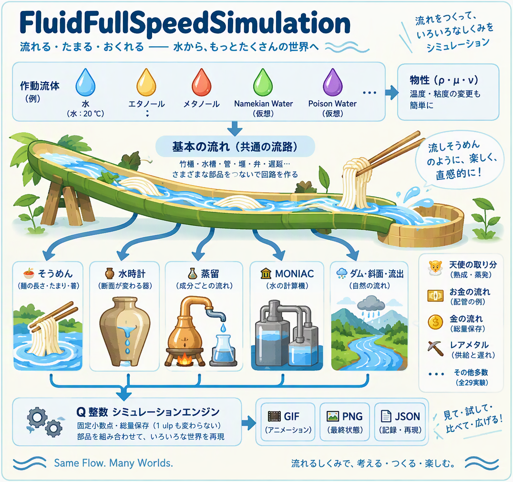](assets/brand/concept-diagram.png)

クリックで拡大できます。切り出したアイコン・ファビコン・概念図は [assets/brand/](assets/brand/) に分けて置いてあります。

## 🎞️ デモ（場面ごとに GIF 1 枚）

`draw` の場面を既定の引数で 1 枚ずつ。断面図は 16 段・40 時刻（最初と最後で一息）、ドット絵は `draw --view files` と同じ。

| 🎞️ | 見どころ |
|---|---|
| 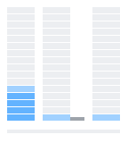 | **D01 🏛️ `moniac-rig`**<br>列: 頭 ｜ 貯める槽 ｜ 戻りの管 ｜ 横の槽。頭から弁で分かれて、貯める槽と横の槽が溜まっていく（0〜20 分） |
|  | **D02 🕳️ `moniac-drain`**<br>ドット絵: 水槽の底の穴から抜けて、床に広がって平らになる |
| 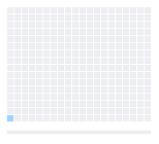 | **D03 🎋 `flume`**<br>空の樋（20 区間）にポンプで流し込む。先端が区間ごとに遅れて届き、10 秒で 🟨 の 🍜 を放す（0〜60 秒） |
| 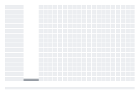 | **D04 🫙 `flume-hopper`**<br>列: じょうご ｜ 遅れ 3 秒の細管（灰色）｜ 樋。じょうごに溜まってから管を通って樋へ（0〜90 秒） |
| 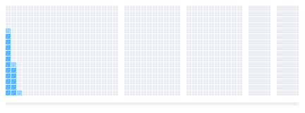 | **D05 🥢 `somen-flume`**<br>列: 竹 3 本 ｜ 受け皿 ｜ 床。継ぎ目の手前にたまりができ、🍜 3 本が流れていく（0〜40 秒） |
| 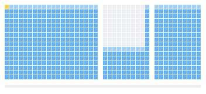 | **D06 🍜 `noodle-length`**<br>長さ 30 cm の麺が区間をまたいで流れる（体 = 頭の後ろの区間を合計 L まで） |
| 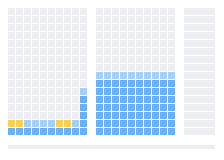 | **D07 🧱 `noodle-clog`**<br>細い流れで束が縁に積もり、たまりが上がって、最後に全部まとめて受け皿へ流れ出す（100〜200 秒） |
| 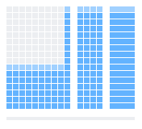 | **D08 🍽️ `chopsticks`**<br>箸で取られた 🍜 はそこで消える。取り逃した分だけ受け皿へ（24〜50 秒） |
| 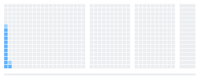 | **D09 🧊 `cold-water`**<br>10 °C の細い流れ。ひやむぎ・そうめんの 2 本が流れる（0〜110 秒） |
| 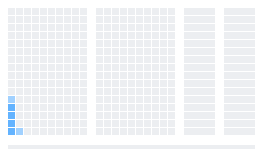 | **D10 🪵 `bamboo-wear`**<br>列: 節のある竹 ｜ 次の竹 ｜ 受け皿 ｜ 床。節の手前にたまり、うどんだけ節で止まる。割れ目の漏れが床へ（0〜100 秒） |
|  | **D11 🌧️ `rain-runoff`**<br>列: 斜面（20 区間）｜ 受け皿。雨が行き渡って下流ほど深く、やむと引いていく（0〜286 秒） |
|  | **D12 🎍 `shishi-odoshi`**<br>列: 筒 ｜ 受け皿。筒はのこぎり歯（溜まる → 傾く → 空く）、受け皿は階段 |
|  | **D13 🍷 `pythagorean-cup` 🟪**<br>列: 杯 ｜ 鉢。頂まで溜まると吸い切られ、鉢が階段。☠️ Poison Water（粘度 5 倍）で |
|  | **D14 🫗 `mariotte`**<br>列: びん ｜ 受け皿。空気管の下端までは一定の速さで下がり、その先は Torricelli で鈍る |
| 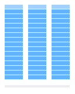 | **D15 🏺 `water-clock`**<br>列: 4 次の放物面 ｜ 筒 ｜ 円すい（口は同じ）。🏺 は一定の速さで下がって空になり、筒は下ほど遅く残り、円すいは先に空く |
|  | **D16 🌊 `dam-break` 🟩**<br>ドット絵のダム決壊。🟩 Namekian Water（粘度 0.8 倍）で |
| 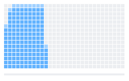 | **D17 🚧 `inertia-limits`**<br>ダム決壊を断面図で（勾配 1 %）。慣性が無いので先端は尖らず、盛り上がったまま下流へずれる（Ritter とは別物、E23） |
| 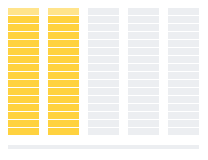 | **D18 ⚗️ `distillation` 🟨**<br>列: 釜 ｜ 前留 ｜ ハート ｜ セコンド ｜ 後留。釜が減り、受け器が順に溜まる（0〜50 分。🟨 は色だけ） |
| 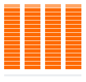 | **D19 👼 `angels-share` 🟧**<br>列: スコットランド ｜ ケンタッキー上の階 ｜ 同 下の階 ｜ 台湾。樽が 30 年かけて減る（1 フレーム = 1 年。🟧 は色だけ） |
| 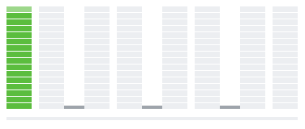 | **D20 💴 `money-flow` 🟩**<br>列: 中央銀行 ｜ メガ銀行 a ｜ T+2 の管 ｜ 証券 a ｜ b ｜ c … ｜ 市中。中央銀行は十分大きい有限の初期残高（2^20 兆）から送り出し、銀行・証券・市中が「出す速さ × 滞在時間」まで溜まる（0〜64 日） |
| 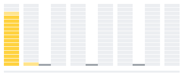 | **D21 🪙 `gold-flow` 🟨**<br>同じ配管に金（総量 128 t）。金庫が減って行き渡り、取り分は滞在時間の比で止まる。1 段 = 総量の 1/16（0〜64 日） |
| 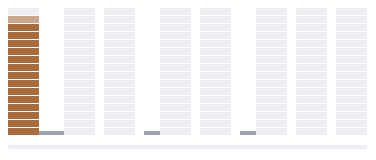 | **D22 ⛏️ `rare-metal` 🟫**<br>列: 産出国 ｜ 船 30 日 ｜ 製錬の加工国 ｜ 部品の加工国 … ｜ 市場。産出国が指数で減り、加工国の在庫は山を作ってから消え、市場に積もる（0〜320 日） |
| 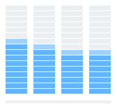 | **D23 🚿 `outlet-count`**<br>列: 別々に取る 1 本 ｜ 2 本 ｜ 4 本 ｜ 8 本 ｜ 厳密に解く 8 本（合計の速さは同じ）。別々に取ると本数が多いほど速く空く。厳密に解く 8 本（右端）は 1 本（左端）と同じ。ずれが見えるように刻みをわざと粗くしてある（dt = τ/2、0〜32 日） |
| 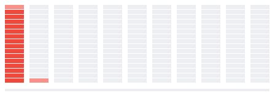 | **D24 🫀 `circulation` 🟥**<br>列: 心臓 ｜ 動脈 ｜ 🧠 脳 ｜ ❤️ 冠動脈 ｜ 🫘 腎臓 ｜ 🍽️ 腸・肝臓 ｜ 💪 筋肉 ｜ 🖐️ 皮膚 ｜ 🦴 その他 ｜ 静脈 ｜ 🫁 肺。最初は血液 5 L が全部心臓に。5 L/min で送り出すと、動脈と器官がすぐ満ち、静脈と肺が遅れて満ちて心臓へ戻り、心臓は 350 mL で止まる（0〜128 秒。🟥 は色だけ） |
| 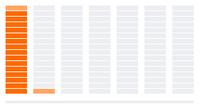 | **D25 🪨 `coal-power` 🟧**<br>列: ⛽ 燃料 ｜ 🔥 ボイラ ｜ ♨️ 蒸気 ｜ 🔌 送電 ｜ 🏠 所内 ｜ 🏭 煙突 ｜ 🌊 海。燃料を一定の速さで燃やし切る。ボイラと蒸気に熱が溜まってから電気が出始め、出口 4 つの傾きが行き先の割合（0〜2048 秒。🟧 は色だけ） |
| 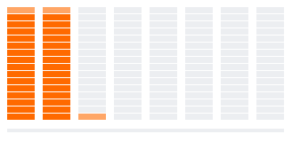 | **D26 🌀 `combined-cycle` 🟧**<br>列: ⛽ 燃料 ｜ 🌀 ガスタービン ｜ ♨️ 排熱回収ボイラ ｜ 蒸気 ｜ 🔌 送電 ｜ 🏠 所内 ｜ 🏭 煙突 ｜ 🌊 海。ガスタービンの電気はすぐ出て、蒸気の分は排熱回収ボイラに溜まってから遅れて足される（0〜2048 秒） |
| 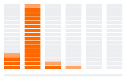 | **D27 ❄️ `heat-pump` 🟧**<br>列: 🔌 電気 ｜ 🌬️ 外気 ｜ 室外の熱交換器 ｜ 圧縮機 ｜ 室内の熱交換器 ｜ 🏠 部屋。電気 705 W と外気から汲む熱 2.9 kW が冷媒に乗って部屋へ。🔌 🌬️ 🏠 は縦いっぱいを揃えてあり、部屋に溜まるのは電気の 5.1 倍（0〜256 秒） |
| 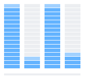 | **D28 🧠 `csf`**<br>列: ふつうの頭の 脳室 ｜ くも膜下腔 ｜ 吸収が止まった頭の 脳室 ｜ くも膜下腔。どちらも回っている状態から 1 日。ふつうの頭は 入る = 出る で動かず、止まった頭のくも膜下腔は作る速さのまま 125 → 629 mL（0〜1440 分） |
| 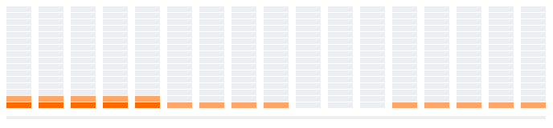 | **D29 💧 `steam-loop` 🟧**<br>列: ボイラ ｜ 高圧タービン ｜ 再熱器 ｜ 低圧の段 1〜6 ｜ 復水器 ｜ 給水加熱器 1〜6 ｜ 給水。高さは比エンタルピー（どこが熱いか、縦いっぱい = 再熱蒸気 3,695 kJ/kg）。冷えた水に火を入れると、ボイラと再熱器が先に熱くなり、低圧の段は階段状に下がり、給水加熱器は抽気で階段状に上がる。水の量はどこも動かない（0〜2048 秒） |
|  | **D30 ♨️ `hrsg-loop` 🟧**<br>列: 高圧の節 ｜ 高圧タービン ｜ 中圧の節 ｜ 再熱器 ｜ 中圧タービン ｜ 低圧の節 ｜ 低圧タービン ｜ 復水器（🌀 の蒸気側、3 圧・再熱）。高圧の蒸気 165 bar(g)・565 °C は高圧タービンで下がり、中圧の蒸気と合流して再熱器で 565 °C に戻り（縦いっぱい = 3,608 kJ/kg）、中圧・低圧タービンで 2,364 kJ/kg まで下がって復水器へ。節ごとの量は pinch で解く（0〜2048 秒） |
|  | **D31 📉 `part-load` 🟧**<br>列は D25 と同じ（🪨）。全負荷で燃やし、1024 秒で 50 % へ下げる。無負荷の燃料（全負荷の 5.8 %）も所内電力の固定の分（全負荷の所内電力の 46 %）も下げても減らないので、🔌 送電の傾きは半分を切り（48 %）、🌊 海の傾きは半分より緩い = 送電端の効率が 42.0 → 38.4 % に下がる（0〜2048 秒） |
| 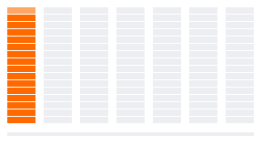 | **D32 🌅 `startup` 🟧**<br>列は D25 と同じ（🪨）。止まった状態から hot 起動: 80 分の暖機は無負荷の燃料だけを燃やして 🌊 海へ（電気は出ない）、25 % で並列して 6 %/分で 13 分かけて全負荷へ。ボイラに熱が溜まってから 🔌 送電が立ち上がる（0〜127 分） |
|  | **D33 🌡️ `metal` 🟥**<br>列: 止まって 8 h ｜ 48 h（🪨 の厚い金属、高さ = 外気より何 K 熱いか、縦いっぱい = 600 °C）。どちらも動いている温度で止まって外気へ冷え、8 h ではほとんど冷えずに 33 分で戻るが、48 h では 315 °C まで下がって 2 K/min で 150 分かけて戻る（0〜52 時間） |
|  | **D34 🫧 `r32-loop` 🟧**<br>列: 室外の熱交換器 ｜ 圧縮機 ｜ 室内の熱交換器（❄️ の冷媒の輪、高さは比エンタルピー、縦いっぱい = 583 kJ/kg）。凝縮した液から回し始め、外気の熱で蒸発し、圧縮機で縦いっぱいまで上がり、部屋へ熱を出して液に戻る（0〜512 秒） |
|  | **D35 🏠 `house` 🟥**<br>列: 外気 2 °C ｜ −15 °C の部屋（高さ = 室温 − 外気、縦いっぱい = 20 °C）。外気の温度から暖め始め、2 °C の部屋は要る分だけ出して 20 °C に、−15 °C の部屋はバランス点（−13.5 °C）より冷たいので最大出力でも 18.2 °C で止まる（0〜4 時間） |

- 🟦 1 段 = 縦いっぱい / 16。縦いっぱいは走らせた中の最大（樋は全区間で共通、水槽はそれぞれ）。いちばん上の段は明るい色（水面）。💴 は中央銀行を除く槽、🪙 ⛏️ は全槽で縦いっぱいを揃えてあるので、その範囲内で列をまたいで量を比べられる。💴 の中央銀行は別スケールで、他の槽と高さを比較できない。🫀 は槽ごと（脳 52.5 mL も静脈 3.2 L も、満ちれば縦いっぱい）。🪨 🌀 は出口 4 つ（送電・所内・煙突・海）を揃え、燃料と段は槽ごと。❄️ は 電気・外気・部屋 を揃える。🧠 はくも膜下腔 2 つを揃え、脳室は槽ごと。💧 ♨️ は比エンタルピーをいちばん熱い槽の値で揃える。📉 🌅 は 🪨 と同じ。🌡️ は 2 つとも動いているときの温度（外気 + 575 K）を縦いっぱいにする。🫧 は 💧 と同じ。🏠 は 2 部屋とも 20 °C を縦いっぱいにする
- 🟨 は運ばれる物（🍜）、灰色の帯は遅れのある管、下の帯は時刻（最初 → 最後）。色は Ironmate の色 ID と派生規則
- 🔁 作り直す: `uv run python fluidfullspeedsimulation.py demos`（`docs/demos/` の GIF と `demos.json` に bytes・sha256）。`demos --check` は書かずにバイト単位で比べ、違えば終了コード 1（CI で確かめる）。`--only 🏛️ D03` で一部だけ
- 🖼️ 1 場面だけ好きな引数で: `draw 🥢 --view files --frames 60 --rows 24 --fill 🟥`（GIF + PNG + 🧾 受領記録 JSON）

## 🚀 使い方

```bash
uv sync --locked                                       # 🔒 uv.lock どおり（実行は標準ライブラリだけ）
uv run python fluidfullspeedsimulation.py verify        # ✅ 全実験 → 終了コード 0 / 1
uv run python fluidfullspeedsimulation.py list          # 🗂️ 実験の一覧
uv run python fluidfullspeedsimulation.py fluids        # 🧪 流体の物性
uv run python fluidfullspeedsimulation.py run flume -v --jsonl plot.jsonl   # 🎋 1 本だけ + 記録
uv run python fluidfullspeedsimulation.py run 🥢                             # 実験はアイコンでも選べる
uv run python fluidfullspeedsimulation.py draw 🏛️ 🟩                         # 場面と流体（ブロック）を絵文字のまま
uv run python fluidfullspeedsimulation.py draw 🥢 🟥                          # 流体でない絵文字は、その色で塗るだけ
uv run python fluidfullspeedsimulation.py draw 🧊 --temp-c 5                  # 🧊 水温を変えて細い流れ（場面: 🏛️ 🥢 🧊 🪵 🎋 🫙 🌊 🕳️）
uv run python fluidfullspeedsimulation.py draw 🥢 --viscosity-scale 8         # 🍯 粘度を 8 倍（--mu 8 なら 8 mPa·s を直接）
uv run python fluidfullspeedsimulation.py draw 🏺 --frames 4                   # 🏺 水時計（4 次の放物面 / 筒 / 円すい）
uv run python fluidfullspeedsimulation.py draw ⚗️ --frames 4                   # ⚗️ 釜と前留・ハート・セコンド・後留
uv run python fluidfullspeedsimulation.py draw 👼 --frames 4                   # 👼 4 つの蔵の樽が 30 年で減っていく
uv run python fluidfullspeedsimulation.py draw 🪙 --frames 4 --rows 16         # 🪙 金庫から行き渡る（💴 ⛏️ も同じ配管）
uv run python fluidfullspeedsimulation.py draw 🫙 --view files --out-dir build/pixel  # 🎞️ 断面図も GIF・PNG・受領記録に
uv run python fluidfullspeedsimulation.py demos --check                      # 🎞️ README のデモが今のコードと同じか
uv run python fluidfullspeedsimulation.py run 🚧                             # 🚧 慣性が要る題材をどれだけ外すか（数で記す）
uv run python -m pytest -q                              # 🧪 テスト（python -S -m unittest discover -s tests でも可）
```

終了コード: `0` ✅ 全検証が通った / `1` ❌ どれかが外れた / `2` 引数の誤り。

| 🧪 | テスト | 中身 |
|---|---|---|
| 🧮 | `tests/test_fixedq.py` | Q 整数・遅れ・カム |
| 🧪 | `tests/test_fluids.py` | 物性・閉じた式・🧊 水温・🍯 粘度・🍷 混合物 |
| 🌊 | `tests/test_network.py` | 回路・🎋 竹の傷み・🍜 麺・🚰 単弁・🧮 丸め方 |
| 🔬 | `tests/test_experiments.py` | E01〜E29 |
| 🟦 | `tests/test_pixelwater.py` | ドット絵・断面図・PNG / GIF・🎞️ デモ |
| ⌨️ | `tests/test_cli.py` | コマンド・絵文字の引数 |
| 🔒 | `tests/test_fleet.py` | vendor の lock・親 workflow の固定 commit（親の `fleet_check.py`） |

### 🐍 / 🟩 名前で呼ぶ（`__main__` を通らない）

```python
from fluidfullspeedsimulation import run_experiment
run_experiment("E05", gain_high=0.03)          # 既定値を上書きして回す

from network import simulate                    # 🧩 回路を JSON の仕様で組む
simulate({"dt": 0.02, "tanks": [{"name": "sea", "area": 1, "volume": 1}],
          "channels": [{"prefix": "flume", "dst": "sea", "length": 2, "cells": 20, "slope": 0.05,
                        "section": {"shape": "semicircle", "size": 0.04}}],
          "links": [{"law": "pump", "src": "sea", "dst": "flume:0", "rate": 5e-5}],
          "tracers": [{"name": "somen", "node": "flume:0", "release": 15, "stop": "sea"}],
          "t_end": 25})
```

```bash
# vendor/py_launch.cjs（親リポジトリの py_launch.cjs を vendor.lock.json で固定。Node 26+）
node vendor/py_launch.cjs --call run_experiment -- fluidfullspeedsimulation.py E08
node vendor/py_launch.cjs --call simulate -- network.py '{"dt":1,"tanks":[...],"links":[...],"t_end":10}'
```

### 🔒 vendor

| ファイル | 元 | 使いどころ |
|---|---|---|
| `vendor/cli_args.py` | myon-bioinformatics/cli_args | CLI の parser（`make_parser`、省略形を受け付けない、終了コード 0/1/2） |
| `vendor/py_launch.cjs` | myon-bioinformatics/myon-bioinformatics | Node から関数を名前で呼ぶ |
| `vendor/fleet_check.py` | myon-bioinformatics/myon-bioinformatics | 🧪 テスト専用。リポジトリ共通の検査（lock・親の固定 commit） |

commit・blob・sha256 は `vendor.lock.json` に固定。更新は親の `vendor_sync.py`（`check` / `update` / `enroll`）で。

戻り値は JSON 越しでも変わらない形（2^53 を超える整数は文字列、∞ は `"inf"`）。

## 🧩 部品

| | 部品 | 中身 |
|---|---|---|
| 🛢️ | `tank` | 水槽。水位 h = V / A。流入 − 流出を積み上げる積分器。`profile=[[h, A(h)], …]` か関数で、高さにより断面が変わる器（🏺）にもなる |
| 🎋 | `channel` | 傾いた樋を区間セルに分けたもの。断面は長方形・半円（竹）。Manning（乱流）/ 層流の薄い流れ |
| 🥢 | `flume` | 竹を継いだ流しそうめんの台。継ぎ目は段差 `drop`（自由落下）か縁 `lip`（たまってから越える）、`bend_radius` の曲がりは外側が持ち上がって縁からあふれる |
| 〰️ | `pipe` | 細管（Hagen–Poiseuille）。速さは動粘度 ν で決まる |
| 🕳️ | `orifice` | 小孔（Torricelli）。流体によらない |
| 🪜 | `weir` / `cam` | 長方形・三角の堰、水位 → 流量の表（特殊形状のスリット） |
| ⛽ | `pump` | 一定流量（`start` から `until` まで） |
| 🌧️ | `rain` | 樋の全区間に一様な雨（区間ごとのポンプ。流量 = 強さ × 平面の幅 × 区間長）。spec では `rains` |
| 🎈 | `float_valve` | 浮き弁。測った水位が遅れの段を通って弁を開く |
| 🚰 | `valve` | 弁つきの出口（MONIAC の弁）。開き具合は一定か、別の水槽の浮き → カムで決まる |
| 🎍 | `tip` / `siphon` / `mariotte` | 溜まる → 閾値 → 一気に: 鹿威しの筒、ピタゴラスの杯のサイフォン、マリオットびんの出口（E19〜E21） |
| ⏳ | `delay` | どの管にも付く輸送の遅れ。管の中の水も総量に数える |
| 🍜 | `tracer` | 流れに乗って運ばれる物（そうめん・葉っぱ）。先入れ先出しで節点を渡る。太さ `size` があると、縁の越流水深が浅いあいだ引っかかる |
| 🔌 | `register_law` | 管の法則を足す口。spec の `law` からもそのまま使える |

## 🧪 実験（ID + 識別子）

| ID | 識別子 | 確かめること |
|---|---|---|
| E01 🧮 | `tank-integrator` | 一定流入 → 体積が整数で厳密に n·(Q·dt)、排水が e^(−t/τ) どおり、2^−s の遅れ = シフト |
| E02 💧 | `fluid-drain` | 細管は ν に比例して遅い（🍶 は 💧 の約 1.51 倍）、小孔は流体によらずビット単位で同じ |
| E03 ⏳ | `transport-delay` | 管を抜ける遅れ L/v と、管の中の水 |
| E04 🪜 | `weir` | 堰・カムの定常水位が閉じた式どおり、粘度によらない |
| E05 🎈 | `float-valve` | 浮き弁の遅れ 1 段は強い弁ほど設定値へ近く静か、3 段では限界ゲインを超えると揺れが残る |
| E06 🌐 | `coupled-loop` | 2 台を遅延管で環につなぐ: 定常の配分、届く時刻、跳ね返りが戻る時刻 |
| E07 🏎️ | `fluid-speed` | 同じ回路を流体だけ変える: 流量は同じ、水位と整定時間は ν の比 |
| E08 🎋 | `flume` | 樋の等流水深、トレーサー（そうめん役）が抜ける時間 L/v、層流は ν に効き Manning は効かない |
| E09 🟦 | `pixel-water` | 断面図: 段数から水深を ±½ 段で読み戻せる、先端の届く時刻の間隔 ≈ Δx/v、じょうごに溜まって段が積み上がる、🍜 は管の遅れの間 ⏳。ドット絵の水: ドット数が毎ティック不変、水面が平ら、静まる順 🧴 < 💧 < 🍶、seed で再現、PNG/GIF の読み戻し |
| E10 🥢 | `somen-flume` | 竹 3 本の台: 継ぎ目のたまり・段差の落下・流しすぎで床へあふれる・細い流れでひやむぎだけ引っかかりそうめんに抜かれる・水を足すと流れ出す |
| E11 🏛️ | `moniac-rig` | MONIAC 型の水回りを据え置きの試験台に: 3 つの弁の分流比、浮き → カムの弁で決まる定常水位、閉じている間は入った量がそのまま貯まる、別の槽の浮きで弁が開く、戻りの管の遅れ。最後の水位は `tests/test_experiments.py` の GOLDEN と比べる |
| E12 🍜 | `noodle-length` | 長さのある麺: 体の区間数 = ceil(L/Δx)、長さは速さを変えず尾は L/v 遅れて通る、頭が縁を越えても尾が掛かっていれば止まる、曲がりで外側の水面 + 太さが縁に届くと麺だけ飛び出す（水は曲がりからこぼれない） |
| E13 🧱 | `noodle-clog` | 麺のたまり: 束が縁に積もるたびにたまりが縁 + Δ_k + 越流水深まで上がり、押す力が摩擦を超える k* 束目で全部まとめて流れ出す（のこぎり歯）。流れ出した束は固まって届く |
| E14 🍽️ | `chopsticks` | 箸ですくう: 入って t_grab 後に挟めた麺だけ取れる（t_grab は麺ごとの一様乱数）。区間にいる時間 Δx/v が短い速い流れほど取れず、手が空くまで（口へ運ぶ間）は取り逃す |
| E15 🧊 | `cold-water` | 水温表（0–40 °C）: 出典間の幅、10 °C の細い流れは等流水深の比どおり深く（×1.08）遅い（×1.12）、縁の越流水深と引っかかりは変わらない、Manning の竹はビット単位で同じ |
| E16 🪵 | `bamboo-wear` | 竹の傷み: 割れ目の漏れ = Cd·a·√(2gh)、床に落ちたのは漏れた分だけ（ulp まで）、節の削り残しの手前のたまり = 節 + 越流水深、細い流れではうどん（2 mm）だけ節で引っかかる |
| E17 🍯 | `viscosity` | 粘度のつまみ: 層流の樋の水深は閉じた式どおり動き、粘いほどそうめんが遅く着く。継ぎ目のたまり・Manning の竹・Cd 一定の小孔はビット単位で同じ。`viscous=True` の小孔は Re が下がると Cd が下がり（低い Re で δ·√Re）抜け方が遅くなる。☠️ Poison Water（×5）の水深 |
| E18 🌧️ | `rain-runoff` | 斜面に降る雨を運動波の閉じた式と比べる: 定常 Q_e = i·B·L と h_e、95 % 到達時刻・立ち上がり Q(i·t)・減衰の特性線解との相対誤差、区間を倍にすると誤差が約半分（1 次の収束）、dt を半分にすると Q(t_e/2) の誤差が半分、Manning は 🍶 でもビット単位で同じ、層流は t_e ∝ ν^(1/3) |
| E19 🎍 | `shishi-odoshi` | 鹿威し: 周期 = V_tip/q + t_dump（2 ステップまで）、clack の間隔は毎回同じ、落ちた量 = 傾いた瞬間の体積 + 傾いている間の注ぎ込み（0 ulp）、受け皿に入ったのは落ちた分だけ。q を A×10^-N で振り 1 周期 1000 ステップで同じ結論 |
| E20 🍷 | `pythagorean-cup` | ピタゴラスの杯: 頂まで溜まるまでサイフォンは流れない、注ぎ込みなしの吸い切る時間 = 2A/(Cd·a·√2g)·(√(h_crest+h_drop) − √h_drop)、吸い口まで吸い切って残り 0 ulp、注ぎ込みありの周期 = A·h_crest/q + RK4 の参照値（3 ステップまで）、吸い切ったあと再び働く |
| E21 🫗 | `mariotte` | マリオットびん: 空気管の下端が水面より下のあいだ流量 Q = Cd·a·√(2g·h_air) で一定（整数で毎ステップ同じ）、水位は直線で下がる、一定のまま流れる時間 = (h0 − h_air)·A/Q、下端から先は Torricelli の曲線（0.1 mm まで） |
| E22 🏺 | `water-clock` | 水時計: 半径 ∝ h^(1/4) の器なら水位が一定の速さで下がり 12 等分の目盛りが等間隔（ずれ 7e-5）、同じ半径の筒は目盛りが 23:…:1 に詰まる、円すいはその間。dt を 1/4 にするとずれも 1/4（1 次）、表の刻みは頭打ち。出口が細い管（Q ∝ h）だと 🏺 でも筒と同じ形に戻る |
| E23 🚧 | `inertia-limits` | 慣性が要る題材は再現しない — 外れ方を数で記す: U 字管はエンジンでは指数関数で落ち着くだけ（一様な管 r 3 mm は実物だと ζ = 0.032 で周期 1.35 s の揺れ、エンジンの τ は 13.6 ms）、ダム決壊の先端は Ritter の 2√(g h0) に届かず勾配で 2 倍以上変わる、負の波が上流へ戻らない、水撃の Δp = ρ c Δv（18 bar）は量として無い |
| E24 ⚗️ | `distillation` | ワインの蒸留: 釜に残る量と組成が Rayleigh 式どおり（ずれ 5e-5、dt で 1 次に減る）、火力を変えても同じ道筋、共沸点（97.2 %）より濃くならない、エタノールと水がそれぞれ 0 ulp。コニャック式の 2 回蒸留で初留 30.4 %（公表 28〜32 %）、60 % で切ったハート 70.2 %（公表 68〜72 %） |
| E25 👼 | `angels-share` | 天使の取り分: 🎯 スコットランドの数字（年 2 %・度数 −0.5 点・湿度 88 %）で 2 つの速さを合わせ、同じ式で 🔮 湿度で度数の上下が入れ替わる湿度 RH* = 55.2 %、乾いた上の階のケンタッキーは度数が上がり湿った下の階は下がる、63.5 % で詰めたスコッチが 40 % を切るまで 44.7 年。閉じた式との差 1e-8 以下、刻みによらない、成分ごとに 0 ulp |
| E26 💴 | `money-flow` | お金の流れ（架空の国。物価・金利・政策なし、配管だけ）: 中央銀行が 0.5 兆/日で出すと、どの槽も 入る速さ × 滞在時間 に落ち着く（離散の定常と 1e-12 以内、連続の式とも 0.002 % 以内）、出す速さを変えると量も同じ倍率、証券に届くのは銀行を出てちょうど 2 日後（T+2）、決済の手元は順番に払うなら払う額 1、同時なら 0.262 で足りる、足りないと未決済は不足分ちょうど |
| E27 🪙 | `gold-flow` | 金に置き換える: 総量 128 t は増えも減りもしない（0 ulp）、行き渡った後の取り分は滞在時間の比（金庫に残る割合 = 1/(1 + Σ 一巡り/τ_feed) = 10.8 %）、全部の時定数を 3.92〜8.18 倍ゆっくりにしても取り分は同じ、遅れの管の中 = 流れる速さ × 遅れ |
| E28 ⛏️ | `rare-metal` | レアメタル: 産出国（埋蔵量 128 kt）→ 船 30 日 → 製錬 → 部品 → 市場。Bateman の鎖どおり、加工国 a の在庫の山は 64.5 日（式 64.52 日）に 27.0001 kt（式 27.00）、刻みを半分にすると誤差も半分（入った量をステップの終わりに足す扱いでは 1.3 % → 0.63 % → 0.31 %、既定では 0.0025 % → 0.0017 % → 0.0004 %）、最初の船はちょうど 30 日後 |
| E29 🚿 | `outlet-count` | 出口の数: 弁を別々に取らせる（`outlets="independent"`）と、n 本で残りが −t·dt·K²·(1 − 1/n)/2 だけ少ない（τ 30 日・dt 0.25 日・120 日で 2 本 −0.83 %、3 本 −1.11 %、4 本 −1.25 %、8 本 −1.46 %）、刻みを半分にすると半分。既定（`outlets="exact"`）は槽ごとに 1 ステップを厳密に解くので、1〜8 本・偏った 3 本・刻みが時定数の半分・弁 + ポンプのどれでも e^(−t/τ) どおり（差 7e-12 以下）、出た量は速さの比で分かれる |
| E30 🫀 | `circulation` | 血液の循環（安静時の大人: 血液 5 L・心拍出量 5 L/min）: 器官は使わずに通すだけなので 入る = 出る（🧠 脳 750 mL/min で ±0、入った量 − 出た量 = いまある量が 0 ulp）、どの槽も 入る速さ × 滞在時間（中心容積の原理 V = F·T、離散の定常と 2e-11 以内）、器官へ行く割合は表どおり、赤血球が一周 60 s（= 血液量 / 心拍出量）。失う割合・ポンプの速さを A×10^-N で振ると、心臓が空になった先は戻ってくる分しか送れない（6.6 % を超えて失うと送る速さが血液量に比例して落ち、ポンプを速くしても 5.35 L/min で頭打ち） |
| E31 🔥 | `thermal-power` | 火力発電（🪨 石炭 USC と 🌀 LNG 複合。エネルギーだけを流す）: 効率 = 段ごとの割合の積 × (1 − 所内率)（離散の定常と 1e-13）、HHV / LHV の比 = 燃料の LHV/HHV（環境省の表と丸めの範囲で一致）、送電の遅れ = 経路ごとの τ の和、どちらも Carnot より低く Curzon–Ahlborn より高い、1975 年の表の 3 発電所は CA の方が実測に近い。τ と出力を A×10^-N で振っても割合は同じ。💧 2 段目は水・蒸気の循環（橘湾 2 号の流量 + 蒸気表）: どの槽も 入る水 = 出る水、比エンタルピーは蒸気表どおり（1e-14）、熱 2,289 MW = 電気 1,050 + 海 1,239、水と熱を別々に 0 ulp、蒸気 → 電気 45.9 % は 🪨 と 2 点差、冷却水 43 m³/s は南港の 100 MW あたりと 1 割以内。抽気を 6 段に分け、データに無い損（発電機・給水ポンプ・排気損）を入れると排気は乾き度 0.963、残りの湿りは蒸気が最大の 92 % なら届く。♨️ 🌀 は 3 圧・再熱（GER-3936A）: 📍 pinch で解いた 高圧 : 中圧 : 低圧 = 70 : 18 : 11 % は西名古屋 7 号系列の 72 : 17 : 11 % と 3 点以内、内部効率 0.896・中圧 0.933、湿り 8.6 %（再熱なしなら 18.7 %）、1 MW あたりの蒸気と GT : ST は同じ発電所と 1 割以内。📉 部分負荷は Willans の直線（無負荷の燃料 🪨 5.8 %・🌀 11.1 %）と所内電力の 固定 + 比例（🪨 固定 46 %）: 75 % の熱消費率を 0.3 %、試験の効率の比を 0.8 点で当てる。🌅 起動（暖機 → 並列 → 負荷上げ）: 起動からの電気 = 燃料が段を通った分 − 段に溜まった熱（1e-9）。🧱 起動時間は厚い金属の冷え方（τ 70 h）と温め直す速さ（2 K/min）から出し、cold は 🪨 197〜267 分・🌀 141〜150 分で Agora の範囲の中 |
| E32 ❄️ | `heat-pump` | ヒートポンプ（🔥 の裏返し。2.8 kW 級エアコンの暖房 3.6 kW / 705 W、JIS の外気 7 °C・室内 20 °C）: 部屋に出る熱 = 電気 + 外気から汲んだ熱（COP 5.11）、Carnot の COP 22.6 より低い（23 %）、温度を A×10^-N で振っても COP_Carnot × η_Carnot = 1、部屋に届く遅れ = τ の和。🔥 の発電所の電気で回すと燃料 1 から部屋に 🪨 2.05・🌀 2.82（直接燃やすと 1 まで）。🫧 2 段目は冷媒（R32 1.06 kg）の輪: 冷媒 ±0、h は物性どおり、電気 + 外気 = 部屋、0 ulp。外気 7 → 2 °C で COP は 0.881 倍、除霜込みで 0.679 倍（同じ級のカタログ 0.670 と 3 % 以内）。🏠 3 段目は最大出力（建築研究所の式、カタログ 3 点を 1 割以内）と JIS の家の負荷線: バランス点 −13.5 °C、−15 °C の部屋は 18.2 °C まで |
| E33 🧠 | `csf` | 脳脊髄液（血液 → 脳室 25 mL → くも膜下腔 125 mL → 血液、0.35 mL/min）: 頭の中は 作る速さ = 吸収する速さ（±0）、量 = 作る速さ × 滞在時間（離散の定常と 3e-13）、1 日に 3.36 回入れ替わる、脳室に入れた色素が血液に出るまで 7.1 時間、吸収が止まると 1 日に 504 mL がそのまま溜まる（0 ulp）、吸収の通りやすさを A×10^-N 倍にするとくも膜下腔は 1/o 倍で釣り合う |

どの実験も ⚖️ 総量の保存（ずれ 0 ulp）と、層流の前提（Re）・Courant 数などの前提条件を一緒に確かめる。
閉じた式とのずれ（δ）は丸めずにそのまま出す（`run -v`）。

## 🟦 断面図（溜まる・流れる・遅れる）

```bash
uv run python fluidfullspeedsimulation.py draw flume-hopper --frames 4 --rows 4   # じょうご → 管（遅れ 3 秒）→ 樋
uv run python fluidfullspeedsimulation.py draw flume --fluid namekian-water         # 🟩 Namekian Water（🏷️ 仮置き）
uv run python fluidfullspeedsimulation.py draw flume --fluid ethanol --fill 🟥      # 色は自由（--fill で何色でも）
uv run python fluidfullspeedsimulation.py draw moniac-rig --frames 4               # 🏛️ 試験台の槽が溜まっていく
uv run python fluidfullspeedsimulation.py draw somen-flume --cap-mode rim          # 🥢 竹の縁を縦いっぱいに
uv run python fluidfullspeedsimulation.py draw bamboo-wear                         # 🎋 節の手前にたまり、うどんが止まる
```

```
⏱️ 30.05
🍜⬜🟦🟦🟦🟦🟦🟦🟦🟦🟦⬜⬜⬜⬜⬜⬜⬜⬜⬜⬜⬜
🟦⬜🟦🟦🟦🟦🟦🟦🟦🟦🟦🟦⬜⬜⬜⬜⬜⬜⬜⬜⬜⬜
🟦⬜🟦🟦🟦🟦🟦🟦🟦🟦🟦🟦🟦⬜⬜⬜⬜⬜⬜⬜⬜⬜
🟦⬜🟦🟦🟦🟦🟦🟦🟦🟦🟦🟦🟦⬜⬜⬜⬜⬜⬜⬜⬜⬜
```

- 列: じょうご ｜ 管（🍜 が中にいる間 ⏳）｜ 樋の 20 区間。行: 高さ（上が深い）
- 📏 段数 = round(水深 / 縦いっぱい × rows)。1 段 = 縦いっぱい / rows なので、段数から水深を ±½ 段で読み戻せる（E09 で確かめる）
- 縦いっぱいは `--cap-mode run-max`（走らせた中の最大。樋は全区間で共通）か `rim`（樋の縁）。`rows` の既定は 8
- 🍜 は水面の段に置く。ブロックの色は自由（`--fill`）。既定は 🟦 水・🟨 エタノール・🟧 メタノール・🟩 Namekian Water・🟪 Poison Water
- 🎞️ `--view files` で同じ格子を GIF（時刻を追う）・PNG（最後の時刻）に。名前は `<prefix><場面>_<流体>_n<時刻の数>_h<段数>_r<NN><suffix>`、既定は 40 時刻・16 段。水槽の列は 4 マス幅、樋の区間・管は 1 マス、組の間は 1 マス空ける。`--fill` の 🟦 🟨 🟧 🟩 🟪 🟥 🟫 は塗る色にも効く

## 🍜 麺の長さ・たまり・箸（E12〜E14）

```bash
uv run python fluidfullspeedsimulation.py draw noodle-length --frames 4   # 🍜 が 3 区間にまたがって流れる
uv run python fluidfullspeedsimulation.py draw noodle-clog --frames 6     # 縁に積もって溜まり、一気に流れる
uv run python fluidfullspeedsimulation.py draw chopsticks --frames 6      # 取られた 🍜 はそこで消える
```

- 🍜 `tracer(..., length=, strands=, density=, friction=)`: 体は頭の後ろに通ってきた区間を合計 length まで（区間の分解能）。体のどこかが「越流水深 < 太さ」の縁に掛かっていれば全体が止まる
- 💨 曲がりでは、外側の壁の水面 + 太さが竹の縁に届くと縁の外へはじき出される（麺は水面に浮いて外側へ寄せられる、とみなす。`EJECT`）
- 🧱 長さのある麺は縁に積もり、縁の高さが Δ = Σ本数·πd²/4 / (π/(2√3)·w) 上がる（平行な円柱の最密充填、w は縁の高さでの水面幅で一定とみなす）。押す力 ρgwΔ(H − lip − Δ/2) が支える力 Σμ(ρ麺 − ρ)g·a·L 以上になると全部まとめて流れ出す
- 🍽️ `catcher(name, node, grab=(最短, 最長), cooldown=, seed=)`: 入ってから t_grab 後に手が空いていれば取る。取った麺は水から外すだけ（水の量は変えない）
- ⚠️ 茹でた麺の密度 1100 kg/m³・竹との摩擦 0.3・挟むまでの時間 0.3〜0.8 s は仮定の値（引数で替えられる）。検証は、それぞれの仕組みが自分の閉じた式どおりに動くかを確かめるもので、実物の値の当否は別

## 🟦 ドット絵の水

GIF は 🎞️ デモの D02 🕳️・D16 🌊。

```bash
uv run python fluidfullspeedsimulation.py draw moniac-drain --fluid ethanol --scale 8 --out-dir build/pixel \
    --file-prefix demo- --file-suffix _try   # 🎞️ GIF + 🖼️ PNG + 🧾 受領記録 JSON
```

- 🧱 `pixelwater.py`: 1 行 = int 1 つのビット盤。落下（真下 → 斜め下）は毎ティック、横の広がりは流体ごとの整数スケジュール（base_rate × ν_water/ν、Bresenham 型の積算）。⚠️ 見た目のたとえで、粘性流れの物理モデルではない
- 📛 名前: `<prefix><場面>_<流体>_s<seed>_t<ティック>_r<NN><suffix>`。`r<NN>` は同じ条件の何回目か（既存なら次の番号）。隣の `<name>.json` に plan（再現の引数）と bytes・sha256
- 🎨 色は Ironmate の色 ID（💧 C02・🍶 C04・🧴 C01、壁 C07）と派生規則。`to_ironmate_artifact` で `ironmate-pixel-grid/1` に出せる
- 🎞️ GIF は標準ライブラリだけ（LZW・前フレームとの差分矩形）。`scale` は 1 マスのピクセル数（既定 8）

## 🧮 ビット計算

- 🔢 Q 形式（`FRAC_BITS = 48`）。掛け算は `(a*b) >> 48`（床）、床の偏りは n ステップで高々 n ulp
- ✂️ `take`: 取り分を切り出して端数は残りへ → 分けた合計が元と完全一致
- 🔀 1 次遅れ（水槽 1 段）は `k = 2^−s` なら `(x − y) >> s` のシフトだけ
- √ Torricelli・堰は `math.isqrt` の整数平方根、樋は「セル体積 → 流量」の表を二分探索で引く
- 🎲 試す値は A×10^−N の A と N を乱数で選ぶ（`fixedq.random_scales`、Aoi の `draw_coefficients` と同じ作り方）。10^−3 刻みの決め打ちにしない

## 🧪 流体（20 °C）

| | ρ [kg/m³] | μ [mPa·s] | ν [mm²/s] | 出典と幅 |
|---|---|---|---|---|
| 💧 water | 998.21 | 1.0016 | 1.003 | List of viscosities / chem-casts（1.0016–1.002） |
| 🍶 ethanol | 789.45 | 1.20 | 1.52 | Lange（密度）、infobox 1.2 / CRC 1.144（幅 1.144–1.20） |
| 🧴 methanol | 791.1 | 0.587 | 0.742 | Flottweg の表（ρ = μ/ν） |

| 🟢 namekian-water | 998.21 | 0.8013 | 0.803 | 🏷️ 仮置き（🟩、さらさら: 粘度は水の 0.8 倍。架空の値） |
| ☠️ poison-water | 998.21 | 5.008 | 5.017 | 🏷️ 仮置き（🟪、どろっと: 粘度は水の 5 倍。架空の値） |

`fluids.FLUIDS` に 1 行足せば流体を増やせる（出典と幅も一緒に書く）。🏷️ 仮置きの流体は描画では選べるが、実験の流体一覧には入れない（粘度の倍率は `fluids.PLACEHOLDER_MU_SCALE`）。

🧊 水温: `get_fluid(key, temp_c)`・`Network(..., temp_c=10)`・spec の `"temp_c"` で μ・ρ が温度表（`fluids.TEMP_TABLES`）から動く。温度での変わり方を表から取り、20 °C では上の表の値にそろえる（比を掛ける）ので、温度を指定しない計算は 1 ビットも変わらない。

| | 範囲 | 出典 |
|---|---|---|
| 💧 water（🏷️ 仮置きも同じ） | 0–40 °C | [Anton Paar Wiki](https://wiki.anton-paar.com/en/water/)（IAPWS 2008、2–40 °C）、0 °C は chem-casts |
| 🍶 ethanol | 0–40 °C | μ: chemeurope Ethanol data page（CHERIC）、ρ: Lange の直線。Kaye & Laby（0 °C 1.873・30 °C 0.983 mPa·s）とは 3〜9 % ずれる |
| 🧴 methanol | 0–25 °C | [Anton Paar Wiki](https://wiki.anton-paar.com/en/methanol/)（Kaye & Laby ほか） |

## 🌧️ 斜面に降る雨（精度比べ）

幅 1 m・長さ 30 m・勾配 5 % の板に一様な雨（Manning: 360 mm/h、層流: 10.8 mm/h）。運動波の閉じた式は流量の形 Q(h) を問わない:
特性線に沿って dh/dt = i、dx/dt = c(h) = dQ/dA なので、出口の水深は t_e = h_e/i（Q(h_e) = i·B·L）まで h = i·t、
流量は Q(i·t)。やんだ後は Q(h)/(i·B) + c(h)·t = L を h について解く（`fluids.overland_*`）。

| 区間数 | dt [s] | 95 % 到達時刻 | 立ち上がり（0.2〜0.8 t_e） | 減衰（0.5〜2 t_e 後） | Q(t_e/2) |
|---|---|---|---|---|---|
| 10 | 0.1 | 25 % | 4.1 % | 25 % | 0.72 % |
| 20 | 0.1 | 14 % | 1.7 % | 13 % | 0.69 % |
| 40 | 0.1 | 7.3 % | 1.7 % | 6.2 % | 0.69 % |
| 80 | 0.1 | 3.4 % | 1.7 % | 2.9 % | 0.69 % |
| 20 | 0.05 | 14 % | 1.3 % | 13 % | 0.35 % |

- 📉 区間に分ける誤差（Δx）: 上流側の区間ほど水がたまりにくく先端がなまる → 95 % 到達は遅れる側にずれ、区間を倍にすると約半分（1 次）
- ⏲️ ステップに分ける誤差（dt）: 雨はそのステップの流出を決めた後に入るので水深が dt だけ遅れる → Q(t_e/2) の誤差 ≈ m·dt/(t_e/2)（m = 5/3）。区間数には依らず、dt を半分にすると半分
- 🔁 定常（Q_e・h_e）は区間数によらず 1e-3 以内。降った量 = 受け皿 + 板に残る水（ulp まで）
- 📐 広い平面のべき乗則 q = α·h^m（Manning: α = √S/n、m = 5/3。層流: α = gS/(3ν)、m = 3）の t_e = (L/(α·i^(m−1)))^(1/m) は、R ≈ h とみなす分（2h/B）だけずれる

```bash
uv run python fluidfullspeedsimulation.py draw 🌧️ --frames 4 --rows 6   # 雨が行き渡り（下流ほど深い）、やむと上流から引く
```

## 🍯 粘度のつまみ

- `get_fluid(key, temp_c, mu=…, mu_scale=…)` / `Network(dt, fluid, temp_c=…, mu=…, mu_scale=…)` / spec の `"mu"`・`"mu_scale"` / `draw --mu`（mPa·s）・`--viscosity-scale`
- 順番は「温度表 → 粘度の指定」。`mu` は温度で動いた粘度を上書きし（密度は温度のまま）、`mu_scale` は掛ける
- 粘度が効くのは ν の入る式だけ: 細管（Hagen–Poiseuille）、層流の樋、管の遅れ、ドット絵の横の広がり。小孔・堰・継ぎ目の縁・Manning は効かない
- 粘い液で小孔を使うなら `orifice(..., viscous=True)`: Re = v·d/ν から Cd = Cd∞·tanh(δ·√Re / Cd∞)（δ = 0.2）を毎ステップ解く。低い Re で δ·√Re（Merritt の層流の傾き）、高い Re で Cd∞ = 0.61。どちらでも結果に Re と `viscous_regime`（Re < 1e4）を残す

## 🎍🍷🫗 溜まる → 閾値 → 一気に（E19〜E21）

同じ「溜まって、ある線を越えると一気に動く」を、答えの分かっている 3 つの器で確かめる。部品は `tip`・`siphon`・`mariotte` の法則（`register_law`）で、spec の `law` からも組める。

| | 器 | 閾値 | 閉じた式 |
|---|---|---|---|
| 🎍 | 鹿威し `tip(v_tip, t_dump, dump_rate)` | 筒の体積が V_tip | 周期 T = V_tip/q + t_dump。傾いている間の注ぎ込みも一緒に落ちる。戻りは時間で決める（力学は解かない） |
| 🍷 | ピタゴラスの杯 `siphon(h_crest, h_drop, area, cd, h_intake)` | 水面が管の頂 | 流量 Cd·a·√(2g·(h + h_drop))。吸い口まで吸い切って止まり（このステップで残りを超えて要求したら、残りだけ流して止める）、また頂まで溜まるのを待つ |
| 🫗 | マリオットびん `mariotte(area, h_air, cd)` | 水面が空気管の下端 | 下端より上は水頭 h_air で一定の Q = Cd·a·√(2g·h_air)。下端より下はふつうの Torricelli |

```bash
uv run python fluidfullspeedsimulation.py draw 🎍 --frames 10 --rows 4   # 筒がのこぎり歯、受け皿が階段
uv run python fluidfullspeedsimulation.py draw 🍷 --frames 8             # 杯が頂で吸い切られる
uv run python fluidfullspeedsimulation.py draw 🫗 🟩                     # びんは直線で下がり、下端から鈍る
```

## 🏺 断面が高さで変わる器

- `tank(name, profile=[[h, A(h)], …])`（間は直線）か `tank(name, h_max, profile=A)`（Python の関数）。0 から h_max まで `samples`（既定 512）に刻んで体積 V(h) を台形で積み上げ、V → h の表（Q 整数の Cam）で水位を引く。h_max の上は一番上の断面で伸ばす
- 細管の出口は Q = c·h を前進 Euler で（断面一定の水槽は今までどおり厳密離散化）。弁は断面一定の水槽だけ
- 流出型の水時計は A(h) ∝ √h（半径 ∝ h^(1/4)、4 次の放物面）で Torricelli の流出と釣り合い dh/dt = −k が一定。k = Cd·a·√(2g h0)/(π r²)、空になる時間 T = h0/k

## 👼 天使の取り分（E25）

⚠️ これは**較正したモデル**で、物理として検証したものではない。🎯 = 出典の数字に合わせた（予測ではない）、📝 = 置いた仮定、🔮 = 較正に使っていない出力。

- 樽の中身（エタノール・水のモル）は、それぞれ 1 次で木を抜けて空へ: `evaporate(rates={ethanol: f·k_e, water: f·k_w(RH)})`
- エタノールは空気に無いので湿度によらない。水は空気の乾きに比例: k_w(RH) = k_w,ref·(1 − RH)/(1 − RH_ref)
- 暑さは 1 つの倍率 f で両方に掛ける（f は各地の年の減りから合わせる）。度数の向きは f によらず RH だけで決まる

| 入力 | 値 | 種類 |
|---|---|---|
| 樽・詰め度数 | 200 L・63.5 % | 🎯 スコッチの標準の詰め度数（whiskipedia） |
| スコットランド | 湿度 88 %・年 2 %・度数 −0.5 点/年 | 🎯 puninwine・alcoholprofessor・hedonism |
| ケンタッキー（上の階） | 湿度 45 %・年 4 % | 🎯 年 4 %（alcoholprofessor）/ 📝 湿度（上の階は暑く乾く: vinepair、数値は仮定） |
| ケンタッキー（下の階） | 湿度 75 %・年 3 % | 📝 下の階は外より湿る（vinepair、数値は仮定） |
| 台湾 | 湿度 80 %・年 11 % | 🎯 年 10〜12 %（thewhiskeywash・milroys）/ 📝 湿度 |

| 合わせた定数（🎯） | 値 |
|---|---|
| k_e（エタノール） | 0.02811 /年 |
| k_w,ref（水、湿度 88 %） | 0.00753 /年 |
| 温度の倍率 f | ケンタッキー上 1.336・下 1.305・台湾 5.29（スコットランド 1） |
| 木が吸う量（任意） | 3.63 L（1 年目の減り 3.75 % に合わせる。木が満ちるまで 📝 約 3 か月） |

| 出力（🔮） | 値 |
|---|---|
| 度数が動かない湿度 RH* | 55.2 %（これより乾けば度数が上がる） |
| ケンタッキー上の階の度数 | 上がる（1 年目 63.71 %）。同じ蔵の下の階は下がる（vinepair の向きと同じ） |
| 台湾の度数 | 下がる（1 年目 61.48 %。湿度 80 % の仮定しだいで、確かめるデータは無い） |
| スコッチが 40 % を切るまで | 44.7 年（そのとき 200 L → 90.3 L） |
| 木の吸い込みありの 2 年目 | 年 2.02 %（1 年目だけ多く減って戻る） |

検証（36/36）: 50 年後の成分が閉じた式 n0·e^(−f·k·t) と 1e-8 以内、1 年を 10〜99 等分しても同じ（厳密離散化）、RH* の樽は 30 年たっても度数が 63.5 % のまま（温度 ×1・×3）、湿度を A×10^-1 で振っても向きは RH* との大小どおり、成分ごとに 0 ulp。

## 💴 🪙 ⛏️ 同じ配管に、流す物を置き換える（E26〜E28）

登場人物は 源 → 拠点 3 つ（それぞれ腕が 1 つ）→ 外。その先は 1 つの槽にまとめて考えない（MONIAC の海と同じ）。時間は日。

| 位置 | 💴 お金（兆） | 🪙 金（t） | ⛏️ レアメタル（kt） |
|---|---|---|---|
| 源 | 中央銀行: 十分大きい有限の初期残高（2^20 兆）から一定の速さで出す（ポンプ） | 金庫: 総量が決まっている。出る量は残りに比例（弁） | 産出国: 埋蔵量が決まっている（弁） |
| 拠点 ×3 | メガ銀行 a・b・c | 同じ | 製錬する加工国 |
| 腕 ×3 | 同じグループの証券（T+2 の遅れ） | 同じ（輸送 2 日） | 部品にする加工国 |
| 外 | 市中（中央銀行へ戻る） | 市中（金庫へ戻る） | 市場（戻らない） |
| 源 → 拠点の遅れ | なし | なし | 船 30 日 |

- 💴 中央銀行を除く各槽は **入る速さ × 滞在時間**。出す速さ 0.5 兆/日・一巡り 33 日で、中央銀行の外に 16.5 兆（銀行 a 2・証券 a 2・市中 8・管の中 0.5 …）。出す速さを 2 倍にすれば全部 2 倍
- 🪙 総量が決まっていると、速さは効かない。取り分は **滞在時間の比** だけで決まる: 金庫 13.8・銀行 a 13.8・証券 a 13.8・市中 55.4・管の中 3.5 t（合計 128）。全部を何倍ゆっくり回しても同じ
- ⛏️ 源が減っていくので定常はない。加工国の在庫は山を作る: 山の時刻 = 船の遅れ + ln(k2/k1)/(k2 − k1)。240 日で市場に 123.7 kt、産出国の残り 0.04 kt
- 🔁 決済（💴）: a が午前に 1 払い、b が午後に 0.75 払うなら a の手元は 1 要る。1 日かけて同時に払えば 差額 0.25 + 1 ステップ分 = 0.262 で足りる
- ⚠️ 物価・金利・信用創造・備蓄・輸出規制は入れていない。同じ槽から弁が何本出ても槽の残りは厳密（🚿 E29）。槽と槽のあいだのずれは残る（刻みの 1 次）

💴 は新規発行を実装したモデルではなく、初期残高を循環させる配管の例。中央銀行の残高も増減し、利用可能な残高が足りなければ指定した流量を維持できない。既定の期間・条件で不足しない大きさを選んでいる。

## 🫀 血液の循環（E30）

心臓 → 動脈 → 器官 7 つ（並列）→ 静脈 → 肺 → 心臓。器官は血液を使わずに通すだけなので、行き渡った後はどの槽も **入る = 出る（±0）**。だから総量 5 L がそのまま回り続ける。時間は秒、量は L。

| 🧩 | 部品 | 安静時の数 |
|---|---|---|
| 🫀 心臓 | ポンプ（一定の速さ）。空になると、そのときあるだけ送る | 5 L/min |
| 🔴 動脈 | 器官への弁 7 本。弁の速さ（1/τ = 血管の通りやすさ）の比が、器官へ行く割合 | 血液の 13 % |
| 🧠 ❤️ 🫘 🍽️ 💪 🖐️ 🦴 器官 | 弁 1 本ずつで静脈へ。細動脈・毛細血管の 7 % を流れの比で分ける | 脳 15・冠動脈 5・腎臓 22・腸と肝臓 25・筋肉 17・皮膚 8・その他 8 % |
| 🔵 静脈 | 弁で肺へ | 64 % |
| 🫁 肺 | 弁で心臓へ | 9 % |
| 🫀 心臓に残る | 残り | 7 % |

- 📐 どの槽も **入る速さ × 滞在時間**（中心容積の原理 V = F·T。💴 🪙 と同じ式）: 脳 750 mL/min × 4.2 s = 52.5 mL、動脈 650 mL（7.8 s）、静脈 3.2 L（38.4 s）、肺 450 mL（5.4 s）、心臓 350 mL（4.2 s）
- 🧠 脳の滞在 4.2 s は、灌流画像で測る平均通過時間（MTT 3.4〜4.2 s）の範囲。1.4 kg の脳なら 3.75 mL/100 g で、脳血液量 2〜5 mL/100 g に入る（どちらも合わせ込んだのではなく、7 % を流れの比で分けた結果）
- 🩸 赤血球 1 つ（先入れ先出し）が一周する時間 = 血液量 / 心拍出量 = 60 s（エンジンは 60.25 s、刻み 0.25 s の 1 つ分）。どの器官も滞在時間が同じなので、どこを通っても同じ
- 🫀 心臓は **戻ってきた分しか送れない**: 送る速さ = min(ポンプの速さ, 血液量 / (T_残り + dt))、T_残り = 心臓以外の滞在の合計 55.8 s
  - 🩸 6.6 % まで失っても 5 L/min のまま（心臓の 350 mL が減るだけ）。それより失うと、送る速さは血液量に比例して落ちる（20 % で 4.28 L/min）
  - ⏩ ポンプだけ速くしても、血管が同じなら 5.35 L/min で頭打ち
- 📏 刻み dt = 0.25 s では、器官の量は連続の式より 0.05 % 多く、そのぶん心臓が 0.14 % 少ない（離散の定常とは 2e-11 以内）
- ⚠️ 拍動・血圧・圧力波（Windkessel）、脳の自動調節（血圧が変わっても流れを保つ）、静脈の収縮・頻脈などの補償、酸素の受け渡しは入れていない。器官ごとの滞在時間の違いも入れていない

## 🔥 火力発電（E31）

1 段目は燃料のエネルギーだけを流す（水・蒸気の循環は下の 💧 2 段目）。燃料は HHV で入れ、HHV − LHV（燃えてできた水蒸気の潜熱）はそのまま煙突へ。熱が溜まる段は弁で行き先へ分かれ、割合の積が効率になる。時間は秒、量は MJ（速さは MW）。

| | 🪨 石炭 USC（磯子新 1 号級） | 🌀 LNG 複合（西名古屋 7-1 号） |
|---|---|---|
| ⚡ 出力（発電端） | 60 万 kW | 118.82 万 kW |
| 🧩 段（τ は仮置き） | ボイラ 512 s → 蒸気 64 s | ガスタービン 8 s → 排熱回収ボイラ 256 s → 蒸気 64 s |
| 🔀 割合 | ボイラ → 蒸気 94 %（仮置き）、蒸気 → 電気 47.9 %（解く） | GT → 電気 42.6 %（7HA.02）、排熱 → 煙突 10.7 %、蒸気 → 電気 40.0 %（解く） |
| 🔌 発電端 / 送電端（LHV） | 45 / 42 % | 63.08 / 61.4 % |
| 🔥 同（HHV） | 43.0 / 40.2 %（表は 43 / 40） | 56.8 / 55.3 % |
| 🧾 行き先（燃料の HHV = 100） | 🔌 40.2・🏠 2.9・🏭 10.1・🌊 46.9 | 🔌 55.3・🏠 1.5・🏭 15.5・🌊 27.7 |
| ⏳ 送電の遅れの平均 | 576 s（512 + 64） | 112 s（GT の分 8 s、蒸気の分 328 s） |
| 📐 Carnot / CA（Tc 25 °C） | 0.659 / 0.416（主蒸気 600 °C） | 0.841 / 0.601（1600 °C） |

- 🧮 効率 = 段ごとの割合の積 × (1 − 所内率)。🌀 は η = η_GT + (1 − η_GT)·η_回収·η_ST（ガスタービンの排熱を蒸気でもう一度使う）。「解く」の割合は発電端の効率に合わせて決めたもの
- 🔥 HHV 基準 / LHV 基準 = 燃料の LHV/HHV（石炭 0.956、天然ガス 0.90）。環境省の表の比（43/45、57.5/64）と丸めの範囲で合う
- 🌊 石炭ではいちばん大きい行き先が海（復水器）。🌀 は排熱をもう一度使うぶん海が減り、ガスは水素が多いぶん煙突（潜熱）が増える
- ⏳ 燃やし始めると、熱が段に溜まる分だけ電気が遅れる: 送電した量 = 送電の速さ × (t − 遅れ)、遅れ = 経路ごとの τ の和を電気の取り分で重み付けたもの（V = F·T と同じ式）
- 📐 どちらも Carnot より下で、Curzon–Ahlborn の 1 − √(Tc/Th) は超える（再熱・再生・複合で、熱の出入りの損を減らした）。1975 年の表の 3 発電所は CA の方が実測に近い
- 🎲 τ を A×10^-N 倍にしても割合は同じで、遅れだけが同じ倍率になる。出力を x 倍にすると全部 x 倍
- ⚠️ 仮置き: 🪨 のボイラ 94 %、どの τ も。ここでは効率を一定で流す（部分負荷は 📉、起動は 🌅、水・蒸気の循環は 💧）。温度・圧力の変化は入れていない

### 💧 2 段目: 水・蒸気の循環

水は 給水 → ボイラ → 高圧タービン → 再熱器 → 低圧タービン（6 段）→ 復水器 → 給水加熱器（6 段）→ 給水 と回り、熱は水に乗って運ばれる（成分モード: 槽ごとに 水 kg と 熱 MJ）。火炉はボイラと再熱器に熱だけを入れ、タービンは熱だけを ⚡ に、復水器は熱だけを 🌊 海に出す。抽気は 高圧 → 給水 の 1 本と、低圧の段 k → 上から k 番目の給水加熱器 の 6 本。

| 🧩 | 値（電源開発 橘湾 2 号、1,050 MW） | h [kJ/kg]（蒸気表） |
|---|---|---|
| 🔥 ボイラ → 主蒸気 | 3,000 t/h、25.0 MPa(g)・600 °C | 3,493（給水 288 °C は 1,270） |
| ♨️ 高圧タービン → 再熱器へ | 2,490 t/h（残り 510 t/h は抽気で給水へ） | 3,064（再熱器入口 345 °C） |
| 🔥 再熱器 → 低圧タービン | 4.28 MPa(g)・610 °C | 3,695 |
| 🌀 低圧タービン 6 段 | 膨張線を h で等分、排気の h は軸の仕事 1,103 MW（下の損を足した分）に合うように解く | 3,494 → 3,294 → … → 2,491 |
| 🌊 復水器 | 主蒸気の 62 % | 134（5 kPa・32 °C） |
| 🔥 給水加熱器 6 段 | 上がり幅を等分（高圧抽気・給水ポンプの仕事と混ざる前の 842 まで）、抽気の量は熱の釣り合いから | 252 → 370 → … → 842 |
| 🔩 データに無い損（Thermoflow の 900 MW 級の熱勘定） | 発電機 98.95 %（1,077,400 / 1,088,803 kW）、給水ポンプを回すタービン 41.8 MW（出力の 3.98 %、仕事は給水へ）、排気損 19.5 kJ/kg（乾き度を出すときに引く） | |

- 💧 どの槽も 入る水 = 出る水（±0）。水の量は通る水 × 滞在時間のまま、火を入れても動かない
- 🌡️ 行き渡った後の比エンタルピーは蒸気表・解いた値（エンジンで 1e-14）。給水の 1,270 kJ/kg は、高圧の抽気と 6 段で温まった水が混ざってできる
- 🧾 ボイラ 1,852 + 再熱器 437 = 2,289 MW の熱 = 電気 1,050 + 海 1,239 MW（復水器 1,227 + 発電機の損 11。第 1 法則）。給水ポンプの 42 MW はタービンから給水へ戻って回るだけ。水と熱をそれぞれ 0 ulp で保存
- 🪜 抽気を段に分けるほど排気は湿った側へ下がる: 乾き度 1 段 1.015（まとめると過熱に見える）→ 2 段 0.983 → 4 段 0.968 → 6 段 0.963 → 8 段 0.961（損を入れないと 1.055 → 1.022 → 1.007 → 1.002 → 1.000）
- 💦 データに無い損を入れると、6 段の排気は乾き度 1.002 → 0.963（湿り 3.7 %）。実機の湿り 10 % 前後までの残りは蒸気の量で説明がつく: 3,000 t/h は最大連続負荷のときの値（日立評論の表 1）で、定格の出力を出す蒸発量（経済的連続蒸発量 ECR）はそれより少ない。ECR が 92.2 %（2,766 t/h）なら湿り 10 %
- 📚 蒸気 → 電気は 45.9 %（Carnot 0.659 より低く、CA 0.416 より高い）。1 段目の 🪨（磯子級、再熱 620 °C）で解いた 47.9 % と 2 点差
- 🌊 海へ出す 1,239 MW を 7 °C 上げる海水は 43 m³/s（100 MW あたり 4.1）。関西電力 南港の既設汽力 60 万 kW の 26.4 m³/s（100 MW あたり 4.4、補機の冷却水込み）と 1 割以内
- ⏳ 冷えた水に火を入れてから行き渡るまで約 30 分（熱が抽気の輪を何周かして給水が温まる）
- ⚠️ 仮置き: ボイラ 94 %、復水器 5 kPa・32 °C、τ（水の滞在時間）、膨張線と給水の上がり幅の等分、損は別の発電所（900 MW 級）の割合。脱気器は入れていない。熱の抜き方は行き渡った後の h で決めたので、起動中の復水器は 134 kJ/kg より下がる（線形のため）

### ♨️ 🌀 の蒸気側: 3 圧・再熱の排熱回収ボイラ

ガスタービンの排熱（1 段目の割合: 煙突 10.7 %、蒸気 89.3 %）で、H 級の 3 圧・再熱の蒸気（GE GER-3936A の表 2）を作る水の輪。復水は 高圧・中圧・低圧の節に分かれ、高圧タービン → 再熱器（中圧の蒸気と合流）→ 中圧タービン → 低圧タービン（低圧の蒸気と合流）→ 復水器 と回る。

📍 節ごとの蒸気の量は pinch で解く: ガスは熱を渡すほど一直線に冷え（比熱一定。煙突の損 10.7 % と西名古屋の煙突の出口 88 °C から、ガスタービンの出口は 614 °C）、高圧・中圧の蒸発器の出口でガス = 飽和 + 10 K。その熱い側で渡せる熱と全体の熱の釣り合いから、3 つの量が決まる。

| 🧩 | 値 | h [kJ/kg]（蒸気表） |
|---|---|---|
| 🔥 高圧の節 → 高圧タービン | 165 bar(g)・565 °C（ドラム 350 °C）、649 t/h | 3,475 |
| ♨️ 高圧タービン・中圧の節 → 再熱器 | 高圧の排気（中圧の蒸気 170 t/h も同じ状態で合流。ドラム 224 °C） | 2,988 |
| 🔥 再熱器 → 中圧タービン | 23.8 bar(g)・565 °C、818 t/h | 3,608 |
| 🌀 中圧タービン・低圧の節 → 低圧タービン | 2.2 bar(g)・277 °C（低圧の蒸気 106 t/h と合流。ドラム 136 °C） | 3,022 |
| 🌊 低圧タービン → 復水器 | 0.04064 bar(a)、925 t/h | 2,364 → 123（飽和水） |
| 🔀 排熱の行き先 | 高圧 55.9・中圧 12.5・再熱器 13.0・低圧 7.9・煙突 10.7 % | |

- 📍 解いた 高圧 : 中圧 : 低圧 = 70.2 : 18.3 : 11.5 %。西名古屋 7 号系列の排熱回収ボイラ（246 : 59 : 36 t/h × 3 基）は 72.1 : 17.3 : 10.6 % で、どれも 3 点以内。残りで作る低圧の蒸発器の出口でも、ガスは飽和より 14.9 K 熱い（作れる）
- 💧 🌡️ 🧾 ⚖️ は 🪨 と同じく成り立つ（水 ±0、h は目標どおり、排熱 966 MW = 蒸気タービン 386 + 海 580 MW、0 ulp）
- 📐 高圧・低圧の内部効率 η は、1 段目で解いた蒸気タービンの出力 386 MW ÷ 発電機 98.95 % に合うように解いて 0.896。中圧はデータ（565 °C → 277 °C）から 0.933。どちらも大型の蒸気タービンの範囲
- 💦 排気の湿りは 8.6 %（排気損を引いて）。同じ η で再熱しないと 18.7 % で、翼の寿命が縮む目安 12 % を超える → だから再熱する
- 🚿 蒸気 925 t/h で 386 MW（1 MW あたり 2.40 t/h）。西名古屋 7 号系列の 1,023 t/h / 388.5 MW（2.63）と 1 割以内
- 🌀 ガスタービン : 蒸気タービン = 802 : 386 MW = 2.08。西名古屋 7 号系列の 769.5 : 388.5 MW（1.98）と 1 割以内。蒸気タービンは全体の 32 %（GE の「約 30 %」）
- 🌊 海へ出す 580 MW を西名古屋の冷却水 25 m³/s で受けると 5.7 °C 上がる（取放水の温度差 7 °C 以下）
- ⚠️ 置いたもの: ガスの比熱は一定、節炭器は飽和まで温める（approach 0）、ドラムの圧力 = タービンの入口、中圧の過熱器の出口 = 高圧の排気、中圧の出口 = 低圧の入口、再熱器の圧損なし、高圧と低圧の η は共通。給水ポンプは電動（所内率に入る）。西名古屋の値は大気 5 °C、蒸気の条件は GE の H 級なので、量の合計は 1 割ほど少ない

### 📉 部分負荷: Willans の直線

燃料 = 無負荷の分 a + (1 − a)·出力（全負荷の燃料を 1）。無負荷の燃料は出力を下げても減らない（海へ）ので、効率は η(x) = η₁·x / (a + (1 − a)·x) と出力とともに下がる。比例の燃料に対する段の割合は、全負荷で出典の効率になるように解き直す。所内電力も 固定 + 比例 の直線: 全負荷の所内電力のうち b は出力によらない（ファン・ポンプ）ので、所内率は aux₁·(b/x + 1 − b)。b の分は 🔌 送電から一定の速さで 🏠 所内へ流す。

| | 🪨 石炭 USC | 🌀 LNG 複合 |
|---|---|---|
| a の決め方 | 630 MW 級 USC の設計の熱消費率 7,485（100 %）・7,920 kJ/kWh（50 %）を結ぶ直線 | 50 % 負荷で全負荷の 9 割（UKERC の典型値） |
| a（無負荷の燃料） | 5.8 % | 11.1 % |
| 効率 100 / 75 / 50 % | 45.0 / 44.1 / 42.5 % | 63.1 / 60.8 / 56.8 % |
| 最低負荷の目安 | 25 %（38.3 %） | 30 %（50.1 %） |
| 🏠 所内率 100 / 75 / 50 / 最低 | 6.7 / 7.7 / 9.8 / 16.0 %（b = 46 %） | 2.6 %（データが無いので一定） |
| 🔌 送電端 100 / 75 / 50 / 最低 | 42.0 / 40.7 / 38.4 / 32.2 % | 61.4 / 59.2 / 55.3 / 48.8 % |

- 📏 100 % と 50 % の直線から 75 % の熱消費率を出すと 7,630 kJ/kWh（設計 7,604、0.3 %）。3 点がほぼ 1 本の直線に乗る
- 🔮 同じ直線から試験の 300 MW / 630 MW の効率の比を出すと 0.940（試験 42.81 / 45.92 = 0.932、0.8 点差）
- 🏠 🪨 の b = 46 % は 660 MW 超臨界の所内率 4.76 %（100 %）・5.95 %（65 %）の 2 点から。全負荷の所内率は表の 6.7 % のまま、形だけを借りた。エンジンの送電端の効率は閉じた式と 1e-9 以内
- 🎲 出力を A×10^-N で振っても、エンジンの送電端の効率は式どおり（1e-9）
- ⚠️ 🌀 にも Willans の直線を当てた（実機は入口案内翼で排気の温度を保つので曲線の形は違う）。🌀 の所内率は負荷によらず一定（負荷ごとのデータが見つからない）

### 🌅 起動: 暖機 → 並列 → 負荷上げ

止まった状態から、無負荷の燃料（📉 の a）を燃やして暖機し（電気は出さず、熱は海へ）、起動時間で最低負荷に並列、1 分ごとに負荷上げの速さだけ上げて全負荷へ。起動時間は 🧱 厚い金属を温め直す時間（下）+ 金属によらない手順の分、負荷上げの速さは Agora の最新の発電所の範囲。

| | 🪨 石炭 | 🌀 GTCC |
|---|---|---|
| ⏱️ 起動時間 hot / cold（最低負荷まで） | 80〜150 / 197〜267 分（Agora 80〜150 / 180〜360） | 31〜40 / 141〜150 分（Agora 30〜40 / 120〜180） |
| 📈 負荷上げ | 3〜6 %/分（25 → 100 % は 13〜25 分） | 4〜8 %/分（30 → 100 % は 9〜18 分） |
| 🏁 全負荷まで（速い側）hot / cold | 93 / 210 分 | 40 / 150 分 |
| 🔥 暖機の燃料（全負荷の何分ぶん、速い側）hot / cold | 4.6 / 11.4 分 | 3.4 / 15.7 分 |

- ⚡ 起動からの電気（送電 + 所内）= 燃やした比例の燃料が段を通った分 − 段に溜まった熱（閉じた式とエンジンが 1e-9 以内。hot・cold とも、範囲のどこかを A×10^-N で選ぶ）
- 🔌 上げきって落ち着いた後の送電は全負荷の定常と同じ（所内率も表の値に戻る）
- 🏠 並列の直後は送電が所内電力の固定の分に足りず、🪨 は 0.4 MWh ほどを系統から受ける（槽は負にならないので、ここでは数えない）
- ⚠️ 簡略: 暖機は無負荷の燃料のまま（実機は点火・昇温・昇圧・タービンの回し上げと段階がある）、並列は最低負荷へ一気に

### 🧱 起動時間を決める厚い金属

タービンのロータや管寄せ・ドラムのような厚い金属は、急に温めると熱応力で傷むので、許される速さでしか温められない。止まっているあいだ金属は外気へ冷える（θ = θ₀·e^(−t/τ)、θ は外気より何 K 熱いか）ので、長く止まるほど温め直しが長い。温めているあいだも冷え続けるとして（dθ/dt = r − θ/τ）、戻るまでの時間は τ·ln((rτ − θ_止)/(rτ − θ₀))。

| | 🪨（600 °C） | 🌀（565 °C） |
|---|---|---|
| 🌡️ 止まって 8 h（hot の境目）/ 48 h（cold の境目） | 538 / 315 °C | 507 / 297 °C |
| 🔥 2 K/min で温め直す | 33 / 150 分 | 31 / 141 分 |
| 🧩 金属によらない手順の分（Agora の hot − 33 分 / 31 分） | 47〜117 分 | 0〜9 分 |
| ⏱️ cold の起動時間 = 手順 + 150 分 / 141 分 | 197〜267 分（Agora 180〜360 の中） | 141〜150 分（Agora 120〜180 の中） |

- 🧱 hot と cold の差（🪨 117 分・🌀 110 分）は、止まっていた 40 時間で冷えた分（🪨 223 K）を 2 K/min で温め直す時間。手順の分は hot から決めて、cold は計算から出す
- 📚 τ = 70 h（自然に冷える HP ドラムの 60〜80 h の真ん中）なら、1 段目の金属が 1,000 °F から 500 °F まで冷えるのに 55 h。ターニングを回し続ける 40〜80 h（米国特許）の中
- ⚙️ 金属の槽（高さ = 温度）を 48 h 冷やして温め直すエンジンの値は、閉じた式と 1e-9 以内
- 🌀 の速い側の hot は金属だけで 31 分（Agora の 30 分を 1 分超える）= 最新の GTCC の hot は、ほぼ金属の温め直しで決まる
- ⚠️ 置いたもの: どの厚い部分も同じ τ と速さ（2 K/min は超臨界の蒸気タービンの許容値）、動いているあいだの金属 = 主蒸気の温度、外気 25 °C。熱を溜める金属の重さは解かない（燃料の数 % なので、時間を決めるのは熱の量ではなく速さ）

## ❄️ ヒートポンプ（E32）

🔥 の裏返し。電気 W で外気から熱 Q_c を汲み、部屋に W + Q_c を出す。エネルギーは増えない（外から運んでくるだけ）ので COP = (W + Q_c)/W は 1 を超えられる。時間は秒、量は kJ（速さは kW）。

| 🧩 | 値 |
|---|---|
| ❄️ 機械 | 2.8 kW 級エアコンの暖房: 3.6 kW を 705 W で（JIS C 9612 の条件: 外気 7 °C・室内 20 °C） |
| 🌀 段（τ は仮置き） | 🌬️ 外気 → 室外の熱交換器 16 s → 圧縮機 8 s（🔌 電気もここへ）→ 室内の熱交換器 32 s → 🏠 部屋 |
| 🧾 部屋に出る熱 | 電気 0.705 + 外気 2.895 = 3.6 kW（外気が 80 %） |
| 📐 COP | 5.11。上限の Carnot の COP = Th/(Th − Tc) = 22.6 の 23 % |

- 🔁 Carnot のヒートポンプは Carnot の熱機関を逆に回したもの: COP = 1/η_Carnot。温度差が小さいほど COP は大きい（🔥 と逆）
- 🪨❄️ 🌀❄️ 発電所の電気で回すと、燃料（HHV）1 から部屋に届く熱 = 送電端の効率 × COP = 🪨 0.402 × 5.11 = 2.05、🌀 0.553 × 5.11 = 2.82。燃料を部屋で直接燃やすと、どれだけ上手に燃やしても 1 まで。COP が 1/η（🪨 2.49、🌀 1.81）を超えれば、発電所で燃やして電気で運ぶ方が暖かい
- ⏳ 部屋に届く熱の遅れの平均 = 経路ごとの τ の和（電気は 40 s、外気の熱は 56 s。取り分で重み付けて 52.9 s）
- ⚠️ 1 段目は熱だけを流す（冷媒の循環と外気温による COP は下の 🫧）。部屋の熱が逃げること、送電の損失は入れていない

### 🫧 2 段目: 冷媒（R32）の輪

同じ機種は R32 を 1.06 kg 封入している。冷媒（g）と熱（kJ）を成分に持つ槽で、室外の熱交換器（蒸発器）→ 圧縮機 → 室内の熱交換器（凝縮器）→ 膨張弁 → 室外 と回す（💧 の水の輪と同じ組み立て）。🔌 電気は圧縮機で、🌬️ 外気の熱は蒸発器で冷媒に入り、凝縮器で 🏠 部屋へ出る。

| 🧩 | 値 | h [kJ/kg]（R32 の物性） |
|---|---|---|
| 🌬️ 室外の熱交換器（蒸発器）→ 圧縮機 | 蒸発 0.15 °C・0.82 MPa、過熱 3.1 K | 519.1 |
| 🔌 圧縮機 → 室内の熱交換器 | 凝縮 39 °C・2.42 MPa（効率 0.70、モータの損も冷媒へ） | 582.8 |
| 🏠 室内の熱交換器 → 膨張弁 → 室外 | 過冷却 7.8 K（膨張弁で h はそのまま） | 257.4 |
| 🔄 冷媒の量 | 3.6 kW / (582.8 − 257.4) = 11.1 g/s（40 kg/h）。1.06 kg が 96 s で一周（τ の比は 1 段目のまま） | |

- 💧 🎯 🌡️ 🧾 ⚖️ は 💧 の水の輪と同じく成り立つ（冷媒 ±0、h は物性どおり 4e-14、電気 0.705 + 外気 2.895 = 部屋 3.6 kW、冷媒と熱を別々に 0 ulp）
- 📐 凝縮温度 39 °C は、冷媒の COP 5.110 がカタログの 3.6 / 0.705 = 5.106 に合うように選んだ（送風機の分は入れない）。蒸発・過熱・過冷却は建築研究所の式（凝縮温度から決まる）
- 🌡️ 凝縮 39 °C は、測った吹き出しの空気 32.4 °C（2.8 kW 級の暖房定格）より高い（熱は熱い側からしか流れない）
- ❄️ 外気 7 → 2 °C（JIS の暖房低温）で蒸発温度が 0.15 → −4.85 °C に下がり、冷媒の COP は 5.11 → 4.50（0.881 倍）。2 °C は湿度が 8 割を超えるので除霜の補正 0.77 を掛けて 0.679 倍。2.8 kW 級（M社）のカタログ 3.6 kW / 910 W → 3.5 kW / 1,320 W の 0.670 倍と 3 % 以内
- ⚠️ 置いたもの: 凝縮温度は外気によらず同じ（同じ能力なら部屋側は変わらない）、圧力の損なし、τ の比、送風機の電力は数えない。部屋の熱が逃げること、最大能力（外気が冷たいほど落ちる）は入れていない

### 🏠 3 段目: 外気で落ちる最大出力と、部屋から逃げる熱

外気が冷たいほど蒸発温度が下がり、吸い込む冷媒が薄くなって、1 回転で運べる熱が減る（最大出力が落ちる）。一方で家から逃げる熱は外気が冷たいほど増える。2 本の線が交わる外気（**バランス点**）より冷たいと、1 台では 20 °C を保てない。

| 🧩 | 値 |
|---|---|
| 📉 最大暖房出力 | 建築研究所の式: 定格暖房 3.6 kW × 最大出力比（外気の 2 次式。係数はこの機種の 定格冷房 2.8 kW・最大暖房 8.8 kW から）× 除霜 0.77（5 °C 未満） |
| 🏠 家の暖房負荷 | JIS の APF の家（同じ部屋の冷暖房）: 外気 17 °C で 0、0 °C で 0.82 × 1.25 × 定格冷房 2.8 = 2.87 kW の直線（UA 169 W/K。17 °C で 0 なのは人・家電・日射の分 3 K）。ISO 16358-2 の表 2 は 0 °C で 0.82 × 7 °C の暖房能力（0.82 は 0 °C で出せる能力の比）で、JIS は同じ部屋にするため暖房の能力を 冷房 × 1.25 に置く |
| ⚖️ バランス点 | −13.5 °C（カタログの −7・−15 °C を直線で結ぶと −14.2 °C、ISO のまま 0.82 × 定格暖房 3.6 = 2.95 kW なら −12.8 °C） |

- 📚 最大暖房出力は カタログの 2 °C 6.4・−7 °C 5.9・−15 °C 5.2 kW に対して 6.25・5.50・5.09 kW（−2.4 %・−6.8 %・−2.1 %）。多くの機種から作った式で、この機種を 1 割以内で当てる（−15 °C は着霜の条件が書かれていないので除霜ありとして）
- 🏠 外気 2 °C の部屋は、要る 2.53 kW だけ出して 20 °C で落ち着く。−15 °C の部屋は最大の 5.09 kW を出しても 18.2 °C まで（入る熱 = 逃げる熱 UA·(室温 − 外気)、エンジンと閉じた式が 1e-9）
- 📚 負荷線の読み方（JIS の 冷房 × 1.25 か、ISO の 定格暖房 か）で 0 °C の負荷は 2.87 / 2.95 kW と 3 % 違うが、バランス点は 0.7 K しか動かず、−15 °C の部屋はどちらも 20 °C に届かない（18.2 / 17.3 °C）
- 🔁 部屋から逃げた熱は外気へ戻る: 外気の熱は冷媒に乗って部屋へ入り、壁と換気から外気へ帰る（熱も回っている）
- ⚠️ 置いたもの: 部屋の熱の滞在時間 τ = 30 分（落ち着いた温度には効かない）。部分負荷の COP（期間の効率・APF）は計算しない

## 🧠 脳脊髄液（E33）

🫀 の血液から作られ、脳の中を回って血液へ戻る小さな循環。脈絡叢がポンプ（作る速さは圧によらない）、くも膜顆粒が弁（吸収は量 = 圧に比例）。時間は分、量は mL。

| 🧩 | 値 |
|---|---|
| 🩸 → 🧠 作る | 0.35 mL/min（約 500 mL/日）。主に脳室の脈絡叢 |
| 🧠 脳室 | 25 mL（滞在 71 分） |
| 🌊 くも膜下腔 | 125 mL（滞在 6 時間）。頭と脊髄のまわり |
| 🩸 吸収 | くも膜顆粒から静脈洞（血液）へ |

- 🧠 頭の中は 作る速さ = 吸収する速さ（入る = 出る、±0）。量 = 作る速さ × 滞在時間（V = F·T、🫀 と同じ式）
- 🔄 1 日に 504 / 150 = 3.36 回入れ替わる（出典は「3〜4 回」「3.7 回」）。脳室に入れた色素は 7.1 時間で血液に出る
- 🚫 吸収が止まると、作るのは圧によらないので 1 日に 504 mL がそのまま溜まる（Q 整数で 0 ulp）。頭蓋骨は硬く中身の合計は変われない（Monro–Kellie）ので、実際には圧が上がる。圧はこのモデルに無い
- 🎲 吸収の通りやすさが o 倍になると、くも膜下腔は 125/o mL で釣り合う（脳室は変わらない）
- ⚠️ 吸収は量に比例すると置いた（実際は静脈洞より圧が高いときだけ流れる）。拍動・呼吸・姿勢、脳の間質液（グリンパティック）、圧そのものは入れていない。医療の判断には使えない

## 🚿 出口の数（E29）

同じ槽から弁が何本か出ているとき、弁を 1 本ずつ別々に計算すると、どの弁も「ステップの最初にあった量」の 1 − e^(−k·dt) を取る。互いの取り分を知らずに取るので、合わせると e^(−K·dt) より少し多く取る（速く空く = 遅れが短く出る）。

**既定は直してある**（`Network(outlets="exact")`）。弁とポンプだけが出ている槽は、1 ステップぶんを厳密に解く（dV/dt = −K·V − q）: 弁の合計は (V + q/K)(1 − e^(−K·dt)) − q·dt、ポンプは q·dt、弁どうしは速さの比で分ける。総量は 1 ulp も変わらない。

| 出口 n 本（合計の速さは同じ） | 1 | 2 | 3 | 4 | 8 |
|---|---|---|---|---|---|
| 別々に取る（`independent`）: 120 日後の残りのずれ | −1e-14 | −0.83 % | −1.11 % | −1.25 % | −1.46 % |
| 厳密に解く（`exact`、既定） | −1e-14 | 7e-12 以下 | 同じ | 同じ | 同じ |

- 🔀 切り替え: `Network(outlets="independent")` で全体、`tank(name, ..., outlets="independent")` で槽ごと。JSON の仕様は `"outlets"`。ずれを測るために残してある
- 📐 別々に取るときのずれ = −t·dt·(K² − Σk_i²)/2。等分なら K²·(1 − 1/n) で、刻みを半分にすると半分（比 2.00）
- 💴 弁とポンプが混ざる槽も厳密（弁 2 本 + ポンプで差 4e-12。別々に取ると −3.2 %）。ポンプだけの槽は元からずれない
- 🔬 命題の判定は [Aoi のサイクル3](https://github.com/myon-bioinformatics/Aoi/tree/50b48729591edcc1fbb9dc4899a52858a2b762b5/cycles/c003-outlets): 25 命題・478 単位。1 次の式が使える刻み、上限の置き直し、弁だけをまとめる方式では足りないこと、遅れの管では変わらないことを判例つきで確かめた
- 🚰 槽と槽のあいだのずれ（上から入る量を同じステップの中で知らない）は、次の節の `inflows="uniform"` が受け持つ
- 🚿 弁が 1 本だけの槽: 全開なら法則のままで厳密。開き具合 o が 1 でなければ、法則（k·o を取る）だと刻みの 1 乗ずれるので、1 − e^(−o·dt/τ) に置き直す
- ⚠️ 細管・オリフィス・樋などが混ざる槽は今までどおり（法則のまま）

## 🚰 入ってくる量の扱い

槽に入った量をステップの終わりに足すだけだと、その量はそのステップのあいだ減らない。半ステップぶん減りそこねるので、下の槽は dt/(2·τ) ほど多くなる（上がポンプなら x/(1 − e^(−x)) − 1、x = dt/τ。時刻によらない）。

**既定は直してある**（`Network(inflows="uniform")`）。このステップに届く量 I が、1 ステップのあいだ一定の速さで入ると見なす。🚿 の式と 1 つにまとまる: 弁の合計 = V·Φ + (I − P)·(1 − Φ/L)（L = K·dt、Φ = 1 − e^(−L)、P = 出るポンプの量）。先に全部の管の量を決めてから弁を増やすので（増やす分は I まで）、槽は負にならず、総量は 1 ulp も変わらない。

| | 入った量を終わりに足す（`end`） | 一定の速さで入ると見なす（`uniform`、既定） |
|---|---|---|
| ポンプ → 槽 → 弁（dt = τ/128） | +0.39 % | 厳密（1e-13） |
| 入るポンプ + 弁 1〜4 本 + 出るポンプ | +0.35 % | 厳密（7e-13） |
| 2 段目（上が弁、dt = τ/128、τ2/τ = 1/3〜8） | +0.05〜1.2 % | 1.5e-5 以下（刻みの 2 次） |
| 3 段目（dt = τ/128） | 最大 1.5 % | 7.4e-5 以下 |
| 輪の行き渡った後の取り分 | 刻みの 1 次でずれる | 厳密 |
| 💴 E26 の定常（連続の式との差） | 0.78 % | 0.002 % |
| ⛏️ E28 の加工国の在庫の山（dt 0.25 日） | 0.31 % | 0.0004 % |
| 🏛️ E11 の頭の槽の水位（閉じた式 0.3） | 0.30075 | 0.3 |

- 🔀 切り替え: `Network(inflows="end")`、JSON の仕様は `"inflows"`。成分モード（🍷）は今までどおり
- 🔬 命題の判定は [Aoi のサイクル3](https://github.com/myon-bioinformatics/Aoi/tree/50b48729591edcc1fbb9dc4899a52858a2b762b5/cycles/c003-outlets)（O27〜O58、Aoi #183 の検証済みコミット。Aoi #183 → Fluid #18 の順に main へ統合済み）
- ⚠️ 上が弁のとき（入る量が 1 ステップの中でも減りながら入る）は厳密ではなく、刻みの 2 次まで小さくなる。増やした分は下の槽の「入る量」に数えないので、段が深いほど効きは落ちる（3 段目で、刻みが時定数の 1/32 以下なら 1/20 以下、1/2 では 1.7 倍どまり）
- 📐 `end` のずれの式: 1 ステップを連続の式に読み替えると G_eff = G − (dt/2)·(D + G²) + O(dt²)（1 列・各槽に弁 1 本の `end` に対する近似。D は G の k_i を k_i² に替えた行列）。次の槽へは半ステップぶん多く入り（k_i·(1 + k_{i+1}·dt/2)）、2 つ先の槽からは引かれる（−(dt/2)·k_i·k_{i+1}）。2 段目は dt/(2·τ2)、3 段目は (dt/2)·[(k2 + k3) − k2·P13(t)/C(t)] で、時刻によって向きまで変わる。3 段・4 段で確かめた（Aoi の O45・O46・O49。段ごとの足し算という予想 O39 は不成立）
- ⚠️ 3 段目で `uniform` のずれが `end` より大きくなることがある。第7弾 cross3 の 245 組中 23 組で起き、h = dt/τ = 1/256 でも 3 組あった。これらは `end` のずれが 0 を横切るステップの前後 1 ステップ以内だった。`end` の 2 次の項まで入れた式と `uniform` の式（G + dt²·H）の予想比が ≥ 1.25 または ≤ 0.8 と言い切った 233 組は、実際の大小と一致した（O55・O56、h ≤ 1/8 の標本内）。粗い刻みへの一般化は O57・O58 で不成立。別の第5弾 chain3b の標本では h ≤ 1/32 で `uniform` の誤差は `end` の 1/13 以下だったが、全条件の保証ではない。
- ⚠️ 効くのは弁とポンプだけが出ている槽。細管・オリフィス・樋などが出口の槽に入る量は今までどおり

## 🧮 丸め方（係数の桁と繰り越し）

量は 2^-48 刻みの整数。丸めは 2 か所で入る。係数を整数にするとき（四捨五入）と、掛け算のたび（切り捨て）。

| 丸め方 | 係数 | 掛け算 |
|---|---|---|
| `q48`（既定。今までどおり） | 2^-48 刻み | 切り捨て |
| `carry64` | 2^-64 刻み（整数の級数で出す。float を通さない） | 切り捨ての残りを場所ごとに持ち、次のステップへ繰り越す |

- 🔀 切り替え: `Network(rounding="carry64")`、JSON の仕様は `"rounding"`。既定は `q48` で、今までの結果は 1 ulp も変わらない
- 🎯 `carry64` が効くのは、弁とポンプだけが出ている槽（槽ごとに厳密に解く設定）。浮きで動く弁は、開き具合が変わるたびに係数を出し直す（開き具合そのものの刻み 2^-48 は変わらない）。ほかの出口がある槽と、成分モード（🍷）は `q48` のまま
- 💧 管を流れる量は整数のままなので、総量は 1 ulp も変わらない
- 📏 2 段の槽（V0 = 128、384 ステップ）で、下の槽の量は 60 桁の小数で進めた値から 4 ulp 以内（`tests/test_network.py` の `Rounding`）
- 🚿 開き具合が 1 でない弁 1 本の槽も、既定で厳密に解く（V·(1 − e^(−開き具合·dt/τ))）。以前は法則のまま V·k·開き具合 で取っていて、刻みの 1 乗ずれていた（開き具合 1/2・t = 2τ・dt/τ = 1/8 で +3.2 %）。法則のままにしたいときは `outlets="independent"`
- 🚰 ポンプが出ている槽は、弁の合計 V·Φ − P·(1 − Φ/L) の P·(1 − Φ/L) も同じ係数と繰り越しで出す（2 段と同じく、厳密な答えから 4 ulp 以内）
- 🔬 もとの実証は [Aoi のサイクル3](https://github.com/myon-bioinformatics/Aoi/tree/main/cycles/c003-outlets)の第13弾・第14弾（丸めの底は係数の丸め。係数の桁を増やして繰り越すと 4 桁近く下がる）。エンジン本体での判定は第15弾

## ⚠️ 慣性が要る題材（再現しない）

このエンジンはストックとフロー（水槽の積分と、水位で決まる流量）だけで、運動量（ẍ）を持たない。慣性で決まる現象は
**直さず**、どれだけ外すかを E23 🚧 `inertia-limits` が数で記す（`draw 🚧` は 1 % 勾配のダム決壊）。

| 題材 | 実物（閉じた式） | エンジン | ずれ |
|---|---|---|---|
| 🔔 U 字管（一様な管 r 3 mm、底 0.3 m、足 0.3 m） | L_eff·ÿ + b·ẏ + 2g·y = 0、ζ = 0.032 → 減衰振動、周期 1.35 s、減衰 7 s | 指数関数、τ = 13.6 ms、揺れは一度も出ない | 種類ごと外す（揺れ続けるものを一瞬で落ち着かせる） |
| 🫗 U 字管（槽 0.01 m²、細管 r 0.75 mm・0.5 m） | ζ = 86 → 揺れない、遅い根 2059 s、速い根 70 ms | τ = 2059 s | 遅い根と 0.003 % 差。足りる |
| 📐 一様な管の境目 | 半径 > 0.54 mm で実物は揺れる（ζ < 1） | どの太さでも揺れない | — |
| 🌊 ダム決壊 h0 0.1 m、勾配 0.1 % | Ritter: 先端 2√(g h0) = 1.98 m/s、0.1·h0 の等深線 1.04 m/s、ダム地点 4/9·h0 | 等深線 0.45 m/s（比 0.43）、ダム地点 0.097 m（比 2.18） | 水面形の RMS ずれ 35 % of h0 |
| 🌊 ダム決壊 h0 0.1 m、勾配 1 % | 同上（Ritter に勾配は無い） | 等深線 1.41 m/s（比 1.35）、ダム地点 0.028 m（比 0.64） | RMS ずれ 49 %。先端 2√(g h0) に対しては 0.71 |
| ↩️ 負の波 | 堤の近くから奥へ水位が下がる（負の波が上流へ戻る） | 奥の壁から堤へ下がる（運動波は下流にしか伝わらない） | 向きが逆 |
| 🟦 ドット絵のダム決壊 | — | 先端は 1 ティックに「斜め 1 + 横の回数」マスまで（実測 1 マス/ティック、平均 0.55） | 規則の上限で、物理ではない |
| 💥 水撃（10 mm 管、Δv 1.27 m/s） | Joukowsky Δp = ρ c Δv = 17.8 bar（水頭 182 m、c = 1400 m/s） | 次のステップで流量 0。圧力という量が無い | 衝撃ごと無視 |

- U 字管の式: 足の面積 A、底の管の面積 a = πr²・長さ L として L_eff = 2·足の高さ + L·A/a、b = 8νLA/(a r²)（Poiseuille の損失をエネルギー法で）。ζ = b / (2√(2g·L_eff))。エンジンの τ = b/2g = A/(2c) は、実物が揺れないときの遅い根に 1/ζ² のオーダーで一致する
- ダム決壊の先端は深さ 0 の尖りなので、水深 0.1·h0 の等深線の速さ（Ritter では (2 − 3√0.1)·√(g h0)）で比べる。エンジンの樋は等流の表（運動波）で勾配が要るため、勾配 0 の Ritter と同じ条件は作れない
- ランダムな Δh（A×10^-N）で単調な緩和・保存を、ランダムな半径で ζ の境目を確かめる

## ⚗️ 蒸留（2 成分の水槽）

- `Network(species=("ethanol", "water"), volume_of=…)` で各水槽が成分ごとの量（モル、Q 整数）を持つ。普通の法則は出す側の組成で床に分け、`boil`・`evaporate` は成分ごとの量を決める。成分ごとの総量は 0 ulp で保存（`parts_error_q`）
- `boil(pot, power=W, cuts=[…])`: 1 ステップに P·dt/λ(y) mol の蒸気。y は気液平衡（Perry's の表、101.3 kPa）。`cuts` で受け器を切り替える（受け器の体積 `volume`、流れ出る留液の度数 `abv_below`）
- 度数は 20 °C の密度表から（エタノールと水は混ぜると縮むので体積は足し算にならない）
- 物差し: Rayleigh 式 ln(W0/W) = ∫ dx/(y − x)。表の直線で区間ごとに厳密に積分する

| 2 回蒸留（25 L・12 % のワイン、5 kW） | 量 | 度数 | 公表 |
|---|---|---|---|
| 🍇 初留（流れ出る度数 5 % で切る） | 9.59 L | 30.4 % | 28〜32 % |
| 前留（初留の 1 %） | 0.10 L | 75.5 % | 約 80 % |
| 🥃 ハート（60 % を切るまで） | 2.57 L | 70.2 % | 68〜72 % |
| セコンド（5 % を切るまで） | 2.95 L | 34.3 % | — |

- 初留の切り方は出典に数がないのでこちらで選んだ（2 % で 26.2 %、3 % で 27.9 %、8 % で 33.2 %）。ハートの 60 % は出典どおり
- 前留・セコンドを次の蒸留へ戻す運用は入れていない（ワイン 9.7 L で 1 L のハート）

## ⚠️ 限界

- 入口・出口損失、温度変化、表面張力は入れていない。Cd（0.61・0.62・0.58）と Manning の n（0.010）は代表値
- 陽解法（同時更新）。樋は Courant ≤ 1 を確かめる。定常水位には流入をステップ頭に入れる分 δ ≈ dt/2τ が残る
- 管の遅れは初期水位の流速で決めた栓流。トレーサーは先入れ先出し（水槽では平均滞留時間に当たる）
- 層流の樋は v = gSR²/(βν)（β: 長方形 3・半円 2）の近似
- 🥢 継ぎ目のたまりは手前の 1 セルにまとめる（上流へのせき上げは解かない）。曲がりの持ち上がりは Δh = v²B/(gR) の近似
- 🌧️ 板の雨は運動波（慣性・圧力勾配なし）と比べる。浸透・表面張力・雨滴の衝撃は入れていない。区間に分ける誤差は 1 次なので、先端の時刻を 1 % にするには 300 区間ほど要る
- 🧊 越流（継ぎ目・節）の式は粘度によらないので、冷やしても引っかかりは変わらない。実際は越流水深が mm 程度だと粘性・表面張力で Cd が下がり、冷水の方が引っかかりやすい可能性があるが入れていない
- 🎋 割れ目は Cd 0.61（薄い縁の穴）。竹の厚み（数 mm）を通る短い管とみれば 0.82 程度まで上がる（E16 の summary に両方）。mm の水深では表面張力で漏れが止まることもあるが入れていない
- 🍜 麺の太さは目安（機械製麺の区分: そうめん < 1.3 mm ≤ ひやむぎ < 1.7 mm）。引っかかりは「越流水深 < 太さ」だけで決める
- 🎍 鹿威しの傾き・戻りは瞬間（傾いている時間 t_dump は与える値）。重心の移動や筒の慣性、落ちる水のはねは解かない
- 🍷 サイフォンは「頂に届けば働く」とみなす（呼び水・管に残る空気・気泡の混入は入れない）。Cd は管の損失をまとめた 1 つの係数。注ぎ込みありの排水時間は閉じた式にならないので RK4 の参照値と比べる
- 🫗 マリオットびんは密閉を仮定し、空気の出入りの抵抗・水面の泡立ちは入れない。空気管の下端を切った瞬間に Torricelli へ切り替える

## 🔁 循環のまとめ（E30〜E33）

どの実験も、エンジンの側は ±0（Q 整数で 0 ulp）と閉じた式（1e-9 以内）で確かめている。そのうえで、出典の値を **入れた・合わせた** もの（🔧）と、入れていない別の出典で **当てた** もの（🔮）を分けておく。モデルが正しいかどうかの証拠になるのは 🔮 だけ。

| | 🔧 入れた・合わせた | 🔮 別の出典で当てた | ⚠️ 置いた |
|---|---|---|---|
| 🫀 血液（E30） | 血液量・心拍出量・器官の割合（教科書の表） | — （V = F·T、静脈還流 = 心拍出量 は式の確認） | 器官の滞在時間は同じ、拍動・血圧なし |
| 🔥 1 段目（E31） | 発電端・送電端の効率、GT の効率、排熱の煙突 10.7 % | HHV/LHV の比（環境省の表）、Carnot > η > CA、1975 年の 3 発電所 | 🪨 ボイラ 94 %、τ |
| 💧 🪨 水・蒸気（E31） | 橘湾 2 号の流量・温度・圧力、Thermoflow の損の割合 | 蒸気 → 電気 45.9 % vs 1 段目 47.9 %、冷却水 vs 南港 | 膨張線と給水の等分。湿り 10 % には「蒸気が最大の 92 % なら」という条件つき |
| ♨️ 🌀 3 圧・再熱（E31） | GE の蒸気条件、pinch 10 K、煙突 88 °C、ST の出力（η を解く） | 節の割合 70.2 : 18.3 : 11.5 vs 西名古屋 72.1 : 17.3 : 10.6、1 MW あたりの蒸気、GT : ST、冷却水、中圧の η | ガスの比熱一定、中圧の出口 = 低圧の入口 |
| 📉 部分負荷（E31） | 熱消費率 100・50 % の 2 点、所内率の 2 点 | 75 % の熱消費率（0.3 %）、試験の効率の比（0.8 点） | 🌀 は直線を当てただけ |
| 🌅 🧱 起動（E31） | Agora の hot の起動時間・負荷上げ、τ 70 h、2 K/min | cold の起動時間が Agora の範囲、τ からのターニングの時間 | 暖機は無負荷の燃料、どの厚い部分も同じ τ |
| 🫧 冷媒（E32） | R32 の物性、建築研究所の式、効率 0.70、カタログに合う凝縮 39 °C | 7 → 2 °C の COP の比 vs 同じ級のカタログ（3 % 以内）、凝縮 > 吹き出し | 凝縮温度は外気によらない |
| 🏠 部屋（E32） | 建築研究所の最大出力の式、JIS の家の負荷線 | 最大出力 vs カタログ 3 点（1 割以内）、バランス点 vs カタログの直線・ISO の負荷線（どちらも 1 K 以内） | 部屋の τ（落ち着いた温度には効かない） |
| 🧠 脳脊髄液（E33） | 作る速さ 0.35 mL/min、量 150 mL | 1 日の入れ替わり 3.36 回 vs 3〜4 回 | 吸収のしきい値・拍動なし |

- 🧭 循環系はここで一区切り。🫀 🔥 ❄️ 🧠 は同じ形（どの槽も入る = 出る、量 = 流れ × 滞在時間）で、運ぶ物（血液・燃料の熱・水と熱・冷媒と熱・脳脊髄液）だけが違う
- 🔮 はどれも出典の範囲か 1 割以内で合った。届かなかったもの（🪨 の排気の湿り）は、差の理由と届く条件を数で示した

## 🗺️ この先

- 🎨 図（文字を入れるならメイリオで統一）
- 🍜 流しそうめん: 麺どうしのからまり、竹の向きを変える分岐、麺の密度・摩擦・挟む時間の実測値
- 🟩 Node 側の鏡合わせ実装（BigInt で同じ整数列になるか）
- 🫀 循環: 1 拍ずつのポンプ、脳の自動調節（浮き弁の cam で動脈の量によらず流れを保つ）、運動時の配分、色素の希釈で心拍出量・血液量を測る（成分モード）
- 🧠 脳脊髄液: 吸収に圧のしきい値（Davson の式）、🫀 の脳の血液と同じ頭蓋に入れる（Monro–Kellie の合計一定）
- 🔁 循環系（🫀 🔥 ❄️ 🧠）は上のまとめで一区切り。やるなら: 🌀 の負荷で変わる所内率（データが見つからず比例のまま。GT2011-45940 は負荷のべき乗の式だが読み取れない）、❄️ 部分負荷の COP と ISO 16358 の外気温の時間で期間の効率（APF）

## 📚 出典

- [Shishi-odoshi — Wikipedia](https://en.wikipedia.org/wiki/Shishi-odoshi)（添水: 竹の筒に水が溜まると傾いて空になり、戻るときに石を打つ）
- [Pythagorean cup — Wikipedia](https://en.wikipedia.org/wiki/Pythagorean_cup)（水面が中の管の頂を越えるとサイフォンが働き、杯の中身を吸い切る）
- [Mariotte's bottle — Wikipedia](https://en.wikipedia.org/wiki/Mariotte%27s_bottle)、[UC Davis: How a Mariotte bottle works](https://lawr.ucdavis.edu/classes/ssc100/Mariotte_bottle.htm)（空気管の下端が大気圧になり、出口を押す水頭は水位によらず一定）

- [Phillips Machine — Wikipedia](https://en.wikipedia.org/wiki/Phillips_Machine)（1949、Lancaster 爆撃機の余剰部品、約 2% の精度、Financephalograph）
- [Ethanol (data page) — Wikipedia](https://en.wikipedia.org/wiki/Ethanol_(data_page))
- [List of viscosities — Wikipedia](https://en.wikipedia.org/wiki/List_of_viscosities)
- [Flottweg: Dynamic viscosity](https://flottweg.com/wiki/separation-technology/dynamic-viscosity)
- [chem-casts: Water viscosity table](https://chem-casts.com/data-tables/water-viscosity-data-table)
- [Sci. Rep. 13, 2023: 鋭いふちの小孔は Re < 10,000 で流量係数が大きく変わる](https://www.nature.com/articles/s41598-023-42451-0)
- [Int. J. Fluid Power: 流量係数は低い Re で √Re に比例、高い Re で一定（Merritt 1967、δ ≈ 0.2）](https://journals.riverpublishers.com/index.php/IJFP/article/download/617/355/1531)
- [Kibler & Woolhiser 1970: The kinematic cascade as a hydrologic model（Colorado State Univ. Hydrology Paper 39。特性線 dx/dt = αN·h^(N−1)・dh/dt = q、減衰 x = x0 + c(h0)(t − t0)、Henderson & Wooding 1964 が斜面に初めて運動波を使ったとの記載）](https://core.ac.uk/download/354408861.pdf)
- [Woolhiser & Liggett 1967: Unsteady, one-dimensional flow over a plane — the rising hydrograph（運動波の数 k）](https://scilit.net/publications/510266709445471b2defde9b7156e398)
- [Ponce ほか: Generalized conceptual modeling of dimensionless overland flow hydrographs（運動波は拡散を持たない、Wooding 1965・Woolhiser & Liggett 1967）](https://ponce.sdsu.edu/generalized_conceptual_modeling_of_dimensionless_overland_flow_hydrographs.html)
- [Torricelli's law — Wikipedia（clepsydra problem: 半径 ∝ h^(1/4) で水位が一定に下がる）](https://en.wikipedia.org/wiki/Torricelli%27s_law)
- [Høyrup 1998, Roskilde: 古代の水時計の出口は細い管で層流（Poiseuille）になりうるため、4 次の放物面でも一定には下がらない](https://rucforsk.ruc.dk/ws/files/4340180/1998_Waterclock_MS.pdf)
- [schoolphysics: Liquid in a U-tube — T = 2π√(L/g)、L は液柱の長さの半分](https://www.schoolphysics.co.uk/age16-19/Mechanics/Simple%20harmonic%20motion/text/Liquid_in_a_u_tube/index.html)
- [WOLF (ULiège): Ritter（1892）のダム決壊の解 — 先端 2c0·t、h = (2c0 − x/t)²/9g](https://wolf.hece.uliege.be/tutorials/wolfgpu_ritter.html)
- [LMNO Engineering: Joukowski 水撃 ΔP = ρ c ΔV（Wylie 1993、Chaudhry 1987）](https://www.lmnoeng.com/WaterHammer/impulse.php)
- [wermac: 水撃の圧力波の速さ（水 21 °C で 1460 m/s）](https://wermac.org/misc/waterhammer.html)
- [Perry's Chemical Engineers' Handbook Table 13-1: エタノール・水の気液平衡（101.3 kPa）](https://es.scribd.com/document/215977942/Paginas-desdeChap13)
- [Wikipedia: Ethanol (data page)（20 °C の水溶液の密度・体積%）](https://en.wikipedia.org/wiki/Ethanol_(data_page))
- [AIChE 2012, Kunz: The Rayleigh Equation Revisited（Rayleigh 式、エタノール・水は Rayleigh 卿の最初の系の一つ）](https://aiche.org/node/94936)
- [cognac.com: 初留 28〜32 %、ハート約 70 %](https://cognac.com/guide/cognac-distillation/)
- [destination-cognac: 60 % を切ったらセコンドへ](https://www.destination-cognac.com/?p=8037)
- [Alcohol Professor: Why Bourbon Gets Stronger and Scotch Gets Weaker with Aging（スコットランド年 2 %・ケンタッキー 4 % 前後、湿ったスコットランドは度数が下がり乾いたケンタッキーは上がる、スコッチは年 0.5 % ほど下がり 40 % を切ると売れない）](https://www.alcoholprofessor.com/blog-posts/bourbon-stronger-scotch-weaker-aging)
- [The Whiskey Wash: What Is "The Angel's Share"?（スコットランド等は年 2 %、インド・台湾は年 12 % まで）](https://thewhiskeywash.com/barrel-ownership/what-is-the-angels-share-2/)
- [Pun in Wine: Angel's Share（スコットランドの蔵は湿度 88 % 前後、1 年目は 3.5〜4 % 減ってから落ち着く）](https://puninwine.com/pages/glossary/angel-s-share)
- [Hedonism: Whisky 101 — What is the Angel's Share?（湿った蔵では度数が年 0.5 % ほど下がり体積は年 2 %）](https://hedonism.co.uk/pages/whisky-101-what-angels-share)
- [Milroy's of Soho: What Is the Angel's Share?（台湾 8〜12 %）](https://milroysofsoho.com/blogs/core-whisky-definitions/what-is-the-angel-s-share-the-whisky-lost-to-maturation)
- [VinePair: Does rickhouse placement matter?（上の階は暑く湿度が低く度数が上がる、下の階は湿って度数が低い）](https://vinepair.com/articles/ask-a-distiller-does-rickhouse-placement-matter-for-whiskey)
- [Whiskipedia: Filling strength（63.5 % が英国の標準の詰め度数）](https://whiskipedia.com/fundamentals/filling-strength/)
- [Young 2010, Control of Cardiac Output — NCBI Bookshelf（表 1.2 血液の体積の分布: 心臓 7・肺 9・動脈 13・細動脈と毛細血管 7・静脈 64 %）](https://www.ncbi.nlm.nih.gov/books/NBK54473/)
- [Columbia Univ.: Regional Circulations（安静時 5000 mL/min の内訳: 冠動脈 5・脳 15・内臓 25・腎臓 22・皮膚 8・筋肉 17・その他 8 %）](https://www.columbia.edu/~kj3/Chapter5.htm)
- [Barrow Quarterly: CT Perfusion Imaging（中心容積の原理 MTT = CBV / CBF）](https://www.barrowneuro.org/for-physicians-researchers/education/grand-rounds-publications-media/barrow-quarterly/volume-17-no-3-2001/ct-perfusion-imaging/)
- [Zaharchuk 2007, AJNR 28:1850（脳血流 50 mL/100 g/min、脳血液量 2〜5 mL/100 g）](https://www.ajnr.org/content/28/10/1850)
- [Newman ほか 2006, AJNR（PMC8133912: 平均通過時間 3.43〜4.18 s、脳血流 43.8〜55.5 mL/100 g/min）](https://pmc.ncbi.nlm.nih.gov/articles/PMC8133912)
- [環境省: 発電技術の BAT 表（USC 90〜110 万 kW 級 発電端 43 (45)・送電端 40 (42) %、GTCC 1650 °C 級 発電端 57.5 (64)・送電端 56 %。括弧は LHV）](https://www.env.go.jp/content/000072257.pdf)
- [磯子火力発電所（新 1 号機 60 万 kW・USC・主蒸気 600 °C・25.0 MPa・HHV 43 % / LHV 45 %）](https://pedia.3rd-in.co.jp/wiki/%E7%A3%AF%E5%AD%90%E7%81%AB%E5%8A%9B%E7%99%BA%E9%9B%BB%E6%89%80)
- [GE: 西名古屋 7-1 号が発電効率 63.08 % でギネス世界記録（2018）](https://www.ge.com/news/press-releases/ges-ha-gas-turbine-delivers-second-world-record-efficiency/jp)、[日刊工業新聞: 118 万 8200 kW、GT 3 台 + ST 1 台、1600 °C](https://www.nikkan.co.jp/articles/view/00448935)、[経済産業省 審査書（1600 °C 級、低位発熱量基準 約 62 %）](https://www.meti.go.jp/policy/safety_security/industrial_safety/sangyo/electric/files/nishinagoya/shinsasyo2.pdf)
- [日立評論 2001: 橘湾 2 号ボイラの主要仕様（主蒸気 3,000 t/h・再熱 2,490 t/h、25.0 MPa(g)/600 °C、再熱 4.28 MPa(g)/610 °C、再熱器入口 345 °C、給水 288 °C）](https://www.hitachihyoron.com/jp/pdf/2001/02/2001_02_08.pdf)。比エンタルピーは IAPWS（Wolfram の ThermodynamicData）
- [大阪府: 南港発電所更新計画 準備書の検討結果（既設 汽力 60 万 kW の冷却水 26.4 m³/s、取放水温度差 7 °C 以下）](https://www.pref.osaka.lg.jp/documents/915/kentoukekka_kandenjunbisyo_2.pdf)、[東京電力: 取放水温度差の管理値 7.0 °C](https://www.tepco.co.jp/nu/kk-np/realtime/cwdesc1-j.html)
- [GE: GER-3936A Advanced Technology Combined Cycles（表 2 の 3 圧・再熱の蒸気条件、蒸気側が出力の約 30 %）](https://courses.washington.edu/mengr430/au07/handouts/ge/class_h_tech.pdf)、[経済産業省: 西名古屋火力発電所リフレッシュ計画の審査書（7 号系列の煙突の出口 88 °C、排熱回収ボイラ 高圧 約 246・中圧 約 59・低圧 約 36 t/h × 3 基、GT 25.65 万 kW × 3・ST 38.85 万 kW、冷却水 25 m³/s・7 °C 以下）](https://www.meti.go.jp/policy/safety_security/industrial_safety/sangyo/electric/files/nishinagoya/shinsasyo2.pdf)、[Mines Paris: 排熱回収ボイラの pinch（5〜15 K）](https://direns.minesparis.psl.eu/Sites/Thopt/en/co/pincement-gvr.html)
- [POWER: 火力の低圧排気の湿りは 10 % 前後](https://www.powermag.com/redesigning-steam-turbines-for-the-smr-era/)、[Turbomachinery: 湿り 12 % を超えると排気側の翼の寿命が縮む](https://www.turbomachinerymag.com/how-steam-conditions-determine-turbine-power-output/)
- [Steam turbine governing — Wikipedia（Willans の直線 ṁ = aL + C、C は無負荷の蒸気）](https://en.wikipedia.org/wiki/Steam_turbine_governing)、[Frontiers 2025: 630 MW USC の熱消費率 7,485 / 7,604 / 7,920 kJ/kWh（100 / 75 / 50 %）と試験 45.92 % / 42.81 %（630 / 300 MW）](https://www.frontiersin.org/journals/energy-research/articles/10.3389/fenrg.2025.1611001/full)
- [UKERC: 50 % 負荷の効率は単純サイクル GT で全負荷の約 8 割、コンバインドで約 9 割](https://ukerc.rl.ac.uk/publications/technical_report/AdHoc_CCS_CC1011_12.pdf)、[Agora Energiewende 2017: 表 1 の最低負荷（最新の石炭 25〜40 %、GTCC 30〜40 %）・負荷上げの速さ・起動時間（最低負荷まで、hot < 8 h・cold > 48 h）](https://www.agora-energiewende.org/fileadmin/Projekte/2017/Flexibility_in_thermal_plants/115_flexibility-report-WEB.pdf)
- [Thermoflow: STEAM PRO の 900 MW 級の熱勘定（蒸気タービンの軸 1,088,803 kW・発電機 1,077,400 kWe・給水ポンプ 42,894 kW・排気損 8.377 BTU/lb）](https://ns1.thermoflow.com/samples/stp/STEAM%20PRO%20output%20HBD%20for%20900MW%20plant%20firing%20Pittsburgh%20No.8%20and%20with%20FGD%20and%20CO2%20capture.pdf)、[日立評論 2005: 250 MVA 空冷の発電機 98.8 %（水素冷却に近い）](https://www.hitachihyoron.com/rev/pdf/2005/r2005_03_105.pdf)、[経済産業省: 定格の出力を出す蒸発量（経済的連続蒸発量 ECR）](https://www.meti.go.jp/policy/safety_security/industrial_safety/oshirase/2003/files/150507.pdf)
- [IIETA: 660 MW 超臨界の所内率 5.95 %（65 %）→ 4.76 %（100 %）](https://www.iieta.org/node/10946)
- [Gülen 2013（Power Engineering）: 自然に冷える HP ドラムの時定数 60〜80 h](https://www.power-eng.com/gas/combined-cycle/gas-turbine-combined-cycle-fast-start-the-physics-behind-the-con/)、[Kosman 2011（Archives of Thermodynamics）: 超臨界の蒸気タービンで許される 2 K/min](https://bibliotekanauki.pl/articles/240243.pdf)、[米国特許 6,898,935: 1 段目の金属が約 500 °F になるまでターニングで 40〜80 h](https://patentimages.storage.googleapis.com/a5/e6/6e/68c3795e8f0a0a/US6898935.pdf)
- [GE Vernova: 7HA.02 単体 42.6 %（LHV）](https://www.gevernova.com/gas-power/products/gas-turbines/7ha)
- [US 6606848（排熱回収ボイラの入熱の約 10.7 % が煙突へ）](https://image-ppubs.uspto.gov/dirsearch-public/print/downloadPdf/6606848)
- [NCASI: HHV → LHV の換算（天然ガス 0.90）](https://www.ncasi.org/wp-content/uploads/2025/09/NCASI_FS-25-01_Conversion-of-HHVs-to-LHVs-for-Various-Fuels-Used-in-the-FPI_09.2025.pdf)、[GREET の発熱量表（瀝青炭 LHV 26.1・HHV 27.3 MJ/kg）](https://courses.grainger.illinois.edu/npre470/sp2018/web/Lower_and_Higher_Heating_Values_of_Gas_Liquid_and_Solid_Fuels.pdf)
- [Endoreversible thermodynamics — Wikipedia（Curzon & Ahlborn 1975 の表: West Thurrock・CANDU・Larderello）](https://en.wikipedia.org/wiki/Endoreversible_thermodynamics)、[DTU: Curzon-Ahlborn-virkningsgraden（Avedøre 2003 は 0.52 で CA 0.41 を超える）](https://dcwww.fysik.dtu.dk/~oltr/Xdrev/evigenergi/noter/0CURZON.DOC)
- [Panasonic CS-TX286D2 仕様（暖房能力 3.6 kW・消費電力 705 W）](https://panasonic.jp/aircon/p-db/CS-TX286D2_spec.html)、[Panasonic TX シリーズ（冷媒 R32・封入量 1.06 kg）](https://panasonic.jp/aircon/26TXseries.html)
- [日本冷凍空調学会 次世代冷媒 2021 Part4（2.8 kW 級 M社 の暖房 標準 3.6 kW / 910 W・低温 3.5 kW / 1,320 W、吹き出し 32.4）](https://jsrae.or.jp/committee/jisedai_R/2021_ProgressR_Part4.pdf)、[建築研究所 4-2（暖房の蒸発温度・過冷却度・過熱度の式 24〜26）](https://www.kenken.go.jp/becc/documents/house/4-2_241202_v14.pdf)、[建築研究所 4-3（除霜の補正 0.77: 5 °C 未満・湿度 80 % 以上、最大暖房出力の式 (1)〜(3)）](https://www.kenken.go.jp/becc/documents/house/4-3_250401_v08.pdf)、[経産省 WG（JIS C 9612:2013 の暖房負荷 100 % = 0.82 × 冷房 × 1.25）](https://www.meti.go.jp/shingikai/enecho/shoene_shinene/sho_energy/air_denki/pdf/003_03_00.pdf)、[ISO 16358-2（6.2 表 2: 暖房の負荷は 17 °C で 0、0 °C で 0.82 × φful(H1)）](https://standards.iteh.ai/catalog/standards/iso/6011cc36-50b4-4329-b6e2-53c3bed6c61e/iso-16358-2-2013)、[Taira ほか（Daikin）2014 Purdue: R32 の圧縮機の効率 70 %（モータの損込み）](https://core.ac.uk/download/77942345.pdf)、[エアコンのカタログ（JIS C 9612 の暖房能力は外気 7 °C・室内 20 °C）](https://www.edion.com/download/2800070304637.pdf)
- [OpenStax College Physics 15.5: ヒートポンプは逆に回した熱機関、COP_hp = 1/Eff](https://openstax.org/books/college-physics/pages/15-5-applications-of-thermodynamics-heat-pumps-and-refrigerators)
- [StatPearls: Physiology, Cerebrospinal Fluid（NCBI Bookshelf: 約 150 mL = くも膜下腔 125 + 脳室 25、主に脈絡叢、くも膜顆粒から静脈洞へ）](https://www.ncbi.nlm.nih.gov/books/NBK519007/)
- [Kanani, Head Injury I – Physiology（Cambridge: 140〜150 mL、0.35 mL/min ≈ 500 mL/日）](https://www.cambridge.org/core/product/identifier/CBO9780511584251A039/type/BOOK_PART)、[Cambridge の章の抜粋（頭蓋内 1600〜1700 mL、Monro–Kellie、1 日に量の 3〜4 倍作る）](https://assets.cambridge.org/97811070/31777/excerpt/9781107031777_excerpt.pdf)
- [ふるなび: そうめんとひやむぎの違い（食品表示基準の太さ区分）](https://furunavi.jp/discovery/knowledge_food/202504-somen_hiyamugi/)
